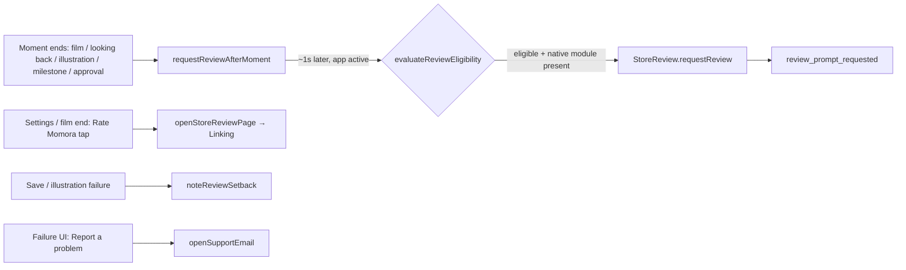

# Feature: App store review prompts

**Status:** `in-progress`
**Last updated:** 2026-10-17
**PRD reference:** none (growth instrumentation, not a product feature)

## Overview

Asks parents for an App Store / Google Play review as often as the store rules allow, at the moments the app makes them feel something: a finished Year Film, a finished Looking Back, a fresh illustration of their own memory, a memory-count milestone, a newly approved family member. It does three things:

1. **Native prompt** (`expo-store-review`: SKStoreReviewController on iOS, the Play In-App Review card on Android). Fired automatically after those moments, behind device-local eligibility rules.
2. **Static "Rate Momora" links** that open the store's write-review page when tapped: Settings → Help, and the Year Film "The end" screen.
3. **A separate "tell us what went wrong" path** at failure points (illustration failed, memory didn't save) that opens a support email. It is never connected to the review flow.

## Store rules this feature must keep (read before changing anything)

Breaking these can get the app rejected or the developer account terminated. Apple's guidelines threaten expulsion for "paid, incentivized, filtered, or fake feedback".

| Rule | Source | What it means here |
|---|---|---|
| Use the provided API to prompt; custom review prompts are disallowed | Apple guideline 5.6.1 | No home-made "Rate us?" popups or modals. The native prompt is the only thing that appears on its own. Static links are fine because the user taps them. |
| No filtered feedback (review gating) | Apple §3 intro; Google Play In-App Review guidelines | **Never** ask "Enjoying Momora?" or "Do you like the app?" and route happy users to the store and unhappy ones to support. No question of any kind before or while the prompt shows. The support path stays at failure points and is never a fork in front of a review ask. |
| No incentives, no forced reviews | Apple 3.2.2(x); Google Play policy | No credits, free months, extra illustrations or giveaways for a review. Never lock functionality behind reviewing. |
| Don't call the native prompt from a button | Apple `requestReview` docs; Google guidelines | It may not show (quotas), so a tap could do nothing. Buttons open the store page via `Linking` instead. |
| Don't ask for a specific rating; don't alter the card | Google Play In-App Review guidelines | Copy never says "5 stars". The native card is shown as-is. |
| Target by usage, never by sentiment | Both | Eligibility uses activity, setbacks and cooldowns. Never use an NPS score, survey answer or reaction to decide who gets asked. This applies off-app too, for example review-ask emails. |

The operating systems also throttle on their own. iOS shows the prompt at most 3 times in 365 days, and at most once per bundle version (OTAs don't count as a new version). Play has an unpublished quota. Neither API says whether the prompt showed or whether the user rated. That's why we can call generously at good moments and let the OS decide.

## User-facing behavior

- **Native prompt triggers** (`ReviewTrigger`):
  - `year_film`: leaving the Year Film player after the film completed or was shared during that visit.
  - `looking_back`: leaving a Looking Back package after it reached the end.
  - `illustration_reveal`: leaving the detail screen of a memory the user created in the last 48h whose illustration is ready.
  - `memory_milestone`: the device's 3rd, 10th, 25th, 50th, 100th and 200th saved memory, on return to the Timeline.
  - `invite_approved`: an owner/manager approves a join request.
  The prompt fires about 1s after the moment ends (after navigation), never over a playing film. It's skipped if the app went to the background in the meantime.
- **Eligibility** (`evaluateReviewEligibility`, device-local):
  - Not web.
  - No setback (failed save or failed illustration) in the last 24h.
  - No request (native prompt or "Rate Momora" tap) in the last 14 days.
  - At least 2 distinct days of app use. **Exception:** the very first `illustration_reveal` can ask on day 1. This is deliberate, because the first illustration of your own family is the app's biggest wow.
- **Static links:** "Rate Momora" in Settings → Help (caption "A quick review helps other parents find us.") and a quiet "Rate Momora" link on the Year Film end screen. iOS opens the App Store's write-review page; Android opens the Play listing (`market://`, falling back to https). Hidden on web.
- **Support path:** "Report a problem" under a failed illustration (next to Retry, so editors only), and "Contact support" under the new-memory save error (online failures only; offline gets the draft-safe message). Both open `mailto:hello@usemomora.com` with a subject and a body that holds only the app version and platform.

## Architecture



All state is one AsyncStorage blob (`momora.reviewPrompt.v1`) on the device: `firstSeenAt`, distinct `activeDays`, `lastRequestedAt`, `requestCount`, `lastSetbackAt`, `savedMemoryCount`. There's no server state, migration or Edge Function.

### OTA safety (native module guard)

`expo-store-review` is a native module that is only in store binaries from **1.5.1** on. OTAs still reach 1.5.0 and 1.4.x binaries, so `src/lib/store-review.ts` never imports it at module scope. It checks that the native module exists, then lazy-requires it inside try/catch, the same pattern as `src/lib/sentry.ts`. On older binaries the native prompt is a silent no-op, while the static links and support path (plain `Linking`) work everywhere. The same JS turns the prompt on automatically once a binary includes the module.

## Data model

None on the server. Device-local AsyncStorage only (see above). A reinstall resets the local cooldown. The OS's own throttling still applies.

## Client integration

| Layer | Files | Responsibility |
|-------|-------|----------------|
| Lib | `src/lib/store-review.ts` | Whole integration surface: eligibility, timers, native guard, store URLs, state |
| Routes | `app/(app)/_layout.tsx` | `recordAppActiveDay()` on mount + foreground |
| Routes | `app/(app)/year-film/[id].tsx`, `app/(app)/looking-back/[id].tsx`, `app/(app)/memory/[id]/index.tsx`, `app/(app)/sharing/approvals.tsx`, `app/(app)/new-memory.tsx` | Trigger call sites; setback + support link at failure points |
| Routes | `app/(app)/(tabs)/settings.tsx` | "Rate Momora" row |
| Components | `src/components/year-films/player/film-completion.tsx` | `onRate` link on the end screen |
| Hooks | `src/hooks/useGenerationStatusPolling.ts`, `src/hooks/useMemoriesRealtime.ts`, `src/hooks/use-pending-memory-uploads.tsx` | `noteReviewSetback()` on failure outcomes |
| Analytics | `src/services/analytics.ts` | `review_prompt_requested`, `review_link_opened`, `support_link_opened` |

### How to add a new trigger

1. Add the name to `ReviewTrigger` (and the analytics union).
2. At the end of the moment, after the user has seen the payoff and ideally as they leave the screen, call `requestReviewAfterMoment('<trigger>', ~800–1500)`. Use an unmount cleanup with a ref if the moment is "finished X then left".
3. Never call it from a button's `onPress`, during onboarding or the paywall, mid-capture, or right after an error.
4. Add a test case and a row to the trigger list above.

## Extension guide

**Safe to extend**

- New triggers at genuine high points (keepsake delivered, artwork framed, first reaction from a grandparent).
- Tuning the 14-day cooldown, the 2-day minimum or the milestones. Measure first: compare `review_prompt_requested` by trigger against daily ratings in App Store Connect / Play Console.
- More static "Rate Momora" links in places the user chooses to tap (no popups).

**Do not change without re-reading the rules table**

- Adding any question, survey, emoji picker or "How are we doing?" step anywhere near a review ask.
- Making the support path conditional on anything review-related.
- Any reward tied to reviewing.

## Constraints & gotchas

- `requestReview` gives no result. `review_prompt_requested` means "we asked the OS", not "the user saw it".
- iOS dev builds always show the prompt (and never submit). TestFlight never shows it. Android only shows the card for builds installed from Play (internal testing track / internal app sharing), never for a sideloaded dev client.
- Privacy: no memory content, names or ids in analytics or the support email body.

## Dependencies

- Depends on: analytics (PostHog), Year Film, Looking Back, memories/illustrations, family sharing approvals.
- Native: `expo-store-review` (store builds 1.5.1+).

## Testing

### Unit tests

| File | Covers |
|------|--------|
| `src/lib/store-review.test.ts` | Eligibility rules (setback, cooldown, active days, day-1 exception, web), store URLs + Android fallback, active-day recording, milestones, native guard / timer behavior |
| `src/lib/support-link.test.ts` | Subject encoding; body carries only version + platform |
| `src/components/year-films/player/film-completion.test.tsx` | `year-film-rate` link renders with `onRate` and is hidden while sharing |

### Integration tests

| File | Scenarios |
|------|-----------|
| `src/screen-tests/settings.notifications.test.tsx` | "Rate Momora" row opens the store URL |
| `src/screen-tests/memory-detail.integration.test.tsx` | "Report a problem" on failed illustrations; illustration-reveal trigger on unmount |
| `src/screen-tests/year-film-player.integration.test.tsx`, `looking-back-viewer.integration.test.tsx`, `sharing.approvals.test.tsx`, `new-memory.integration.test.tsx` | Trigger call sites, setbacks, save-failure support link |
| `src/hooks/useGenerationStatusPolling.test.tsx`, `useMemoriesRealtime.test.tsx`, `use-pending-memory-uploads.test.tsx` | Setback recorded on failure outcomes |

### E2E (Maestro)

| Flow | Scenario |
|------|----------|
| `.maestro/flows/settings/rate-app-row.yaml` | Settings shows the "Rate Momora" row (visibility only; tapping leaves the app) |

### Run this feature's tests

```bash
npx jest src/lib/store-review.test.ts src/lib/support-link.test.ts src/components/year-films/player/film-completion.test.tsx
```

## Changelog

| Date | Change |
|------|--------|
| 2026-10-17 | Initial implementation: native prompt triggers (active from store build 1.5.1), static Rate links + support path (OTA-safe) |
