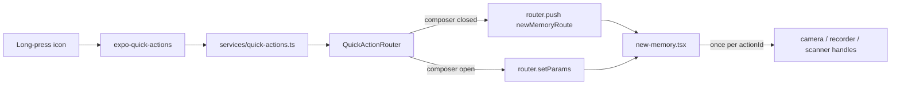

# Feature: App shortcuts (long-press the app icon)

**Status:** `in-progress` (JS complete; needs a new native build and device QA)
**Last updated:** 2026-10-11
**PRD reference:** Journey A — Capture (faster entry points)

## Overview

Long-pressing the Momora icon (iOS Home Screen Quick Actions, Android app
shortcuts) offers four ways to start capturing: **New memory**, **Take a
photo**, **Record audio** and **Scan artwork**. Each opens the memory composer
and, for the last three, immediately starts the matching capture path so the
parent skips a tap or two while the moment is happening.

## User-facing behavior

- Shortcuts exist only for a signed-in, non-anonymous user with an active
  family whose role can edit content (`canEditFamilyContent`: owner/manager).
  They are cleared on sign-out and when the user cannot create memories.
- **New memory** opens the composer. **Take a photo** opens it and launches the
  camera (the same path as Add media -> Take photo). **Record audio** opens it
  and the voice recorder (same as the mic button; the composer's `fork`
  capture mode then asks whether to turn it into text or keep the sound).
  **Scan artwork** opens it and starts the document scanner (same as the scan
  button, including the first-use intro sheet).
- If the composer is already open, the action runs on that composer and the
  draft is kept; a second composer is never stacked.
- Actions wait for the screen to be safe: billing loaded with write access,
  members loaded, draft restore settled. A viewer, a signed-out user, or a user
  with no family gets nothing (normal routing applies, and the action is not
  replayed after a later sign-in).
- Icons: iOS uses SF Symbols (`square.and.pencil`, `camera`, `mic`,
  `doc.viewfinder`). Android uses adaptive icons (pink outline glyph on white)
  generated at prebuild by the `expo-quick-actions` plugin from
  `assets/images/shortcuts/*.png` (`androidIcons` in app.json; the resource
  name is each shortcut's `androidIcon`). The PNGs are 1024px adaptive
  foregrounds with the glyph inside the 66dp safe zone; they were drawn with a
  small PIL script, so a new one should match the stroke weight and sizing.

## Architecture



`QuickActionRouter` (mounted in `app/_layout.tsx` beside `IncomingShareRouter`)
receives the trigger from the cold-start `initial` action or the warm-start
listener, holds it as pending, and acts only after auth and family loading
settle and routing has reached the `(app)` screens (a pending action that never
gets there is dropped after 10 s). It generates an `actionId` and navigates with
`action`, `actionId` and `source` route params. The composer owns running the
action: an effect keyed by `actionId` (consume-once ref) fires it when the
screen is ready, then clears the params. Back navigation, re-render, resume or a
remount with the same params never re-fires the camera/recorder/scanner.

Shortcuts are set at runtime with `QuickActions.setItems` (identical on both
platforms). The library's static `iosActions` config plugin option is not used:
it would show the items to signed-out users and viewers and cannot be cleared
per account without the dynamic API anyway.

## Client integration

| Layer | Files | Responsibility |
|-------|-------|----------------|
| Routes | `src/lib/routes.ts` | `newMemoryRoute(source, { action, actionId })`, `NewMemoryAction`, `parseNewMemoryAction`, the four `shortcut_*` sources |
| Services | `src/services/quick-actions.ts` | Lazy, guarded `expo-quick-actions` load; `SHORTCUTS` list; `setQuickActionsEnabled`; `subscribeToQuickActions` |
| Components | `src/components/quick-action-router.tsx` | Publishes/clears items; pending-until-settled routing |
| Composer | `app/(app)/new-memory.tsx` | Reads `action`/`actionId`, readiness gate, consume-once effect |
| Handles | `MemoryMediaPicker` (`takePhoto()`), `ArtworkScanButton` (`startScan()`) | Imperative entry points that reuse the existing handlers and respect `disabled` |
| Analytics | `src/services/analytics.ts` | `memory_saved.source` gains `shortcut_text/photo/voice/scan` |
| Native | `app.json` plugin `expo-quick-actions`, `__mocks__/expo-quick-actions.ts` | |

### OTA vs native build

This ships in a **new native build** (the plugin adds native code). The same JS
also reaches older binaries over the air. `src/services/quick-actions.ts` loads
the module with a guarded `require` (pattern of `getBackgroundTaskModules`), so a
binary without it silently gets no shortcuts and nothing crashes. Never import
`expo-quick-actions` at module scope anywhere else.

## Extension guide

**Add a 5th shortcut** (iOS shows at most 4 dynamic items; Android recommends 4,
so this means replacing one or moving to a different surface):

1. Add the action name to `NEW_MEMORY_ACTIONS` in `src/lib/routes.ts`.
2. Add a `shortcut_<name>` source to `NewMemorySource`, the `memory_saved.source`
   union in `src/services/analytics.ts`, and `normalizeMemorySavedSource` in
   `app/(app)/new-memory.tsx`.
3. Add an entry (stable `id`, title, SF Symbol) to `SHORTCUTS` in
   `src/services/quick-actions.ts` and map the action to its source in
   `SOURCE_BY_ACTION` in `quick-action-router.tsx`.
4. Handle the action in the composer's consume-once effect (add an imperative
   handle to the target component if it is a child, respecting its `disabled`).
5. Add router and composer tests and a deep-link step to the Maestro flow.

**Do not change without updating this doc**

- The consume-once-per-`actionId` guarantee and the readiness gate (never launch
  the camera on a screen about to bounce to the paywall or back).
- The lazy module guard.

## Constraints & gotchas

- The composer is a native modal, so actions wait for its `transitionEnd` (or a 700 ms fallback) before presenting the camera, scanner or recorder; presenting during the animation fails silently on iOS. Once settled it stays settled, so a `setParams` action on an open composer runs at once.
- No memory content is logged; the shortcut carries only an action name.
- The recorder is opened exactly as the mic button does; do not special-case the
  `VoiceSpeakItModal` or its `captureMode`.
- iOS/Android permission prompts (camera) appear after the composer opens, as
  they do from the toolbar.
- Android launcher shortcuts survive sign-out until `setItems([])` runs, so a
  stale shortcut can be tapped while signed out; the router drops it.

## Dependencies

- Depends on: [voice journaling](./voice-journaling.md) paths, [artwork](./artwork.md) scanner, family roles.
- Used by: none.

## Testing

### Unit tests

| File | Covers |
|------|--------|
| `src/lib/routes.test.ts` | `newMemoryRoute` action params, `parseNewMemoryAction` |
| `src/components/quick-action-router.test.tsx` | Items set/cleared by auth/role, cold/warm start, pending until settled, signed-out/viewer drop, push vs setParams, missing native module |

### Integration tests

| File | Scenarios |
|------|-----------|
| `src/screen-tests/new-memory.quick-actions.integration.test.tsx` | Each action fires once, not before ready, not on rerender with the same `actionId`, fires for a new one, disabled states, draft kept |

### E2E (Maestro)

| Flow | Scenario |
|------|----------|
| `.maestro/flows/shortcuts/open-composer-actions.yaml` | Deep links with `action`/`actionId` open the composer and recorder (authored, not yet executed) |

### Run this feature's tests

```bash
npx jest src/components/quick-action-router.test.tsx src/lib/routes.test.ts src/screen-tests/new-memory.quick-actions.integration.test.tsx
```
