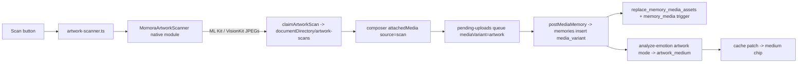

# Feature: Artwork (scanned children's drawings)

**Status:** `in-progress` (built on branch `artwork-scanning`; nothing ships until the audio-trim work has landed and the merge is device-verified — see [the plan](../plans/artwork-scanning.md))
**Last updated:** 2026-10-10 (v2 "soul": frames, wall card, deck, gallery wall, intro, icons)
**PRD reference:** §6.3 Journal Entries (Memories) — `media` type, scanned-artwork variant

## Overview

A parent taps **Scan artwork** in the new-memory composer, scans 1–10 of their child's drawings with the platform's native document scanner (edges auto-detected, perspective corrected), and saves them as a `media` memory flagged as **artwork**. The memory hangs in a playful scrapbook frame on the Timeline and on a gallery wall on the memory detail screen (see [Soul (v2)](#soul-v2-frames-wall-card-deck-gallery-wall)), and an AI-suggested **medium** chip (crayon, watercolor, …) takes the emotion chip's place. Everything else reuses the existing composer and `media` plumbing: tagging = artist, caption = title (optional), tagged-member age = age at creation (the existing detail age row), memory date = scan date (today, editable).

Artwork is **not a new memory type**. It is `memory_type = 'media'` plus `memories.media_variant = 'artwork'`, so every existing media path (upload, queue, carousel, share, export, search) keeps working unchanged. Related: [media-memories.md](./media-memories.md), [memory-analysis.md](./memory-analysis.md), [data-export.md](./data-export.md).

## User-facing behavior

- **Scan button** in the composer toolbar (mic · photo · **scan** · AI toggle; the three buttons use the hand-drawn `SoundIcon` / `PhotosIcon` / `ScanArtIcon`). The first tap on a device shows the intro sheet before the scanner opens. Hidden entirely when the binary has no native scanner (OTA-only older binaries, Expo Go, web, iOS simulator). `isArtworkScannerAvailable()` is the single gate.
- **One scan session → one memory**, up to 10 pieces (`MAX_MEMORY_MEDIA_ASSETS`), shown as a carousel inside one frame. More scans can be added to the same unsaved memory until 10.
- **No mixing.** Scans and library photos/videos are mutually exclusive in a composer, and scans can't be combined with a kept sound: the photo button disables once a scan is attached; the scan button disables once a library photo or a sound is attached. A regular media memory can never get scans added. The mic still dictates the caption on artwork (Speak It opens in `dictate` mode — no "keep the sound" fork).
- **Incoming OS share while scans are attached** is refused ("This memory is artwork. Save it first, then share photos.") rather than replacing the scans.
- **Page cap.** Android's scanner enforces the remaining-slot cap in its own UI. iOS VisionKit has no limit, so the app truncates to the remaining slots and says so inline: a note "Scan up to N pieces. Extra pages are left out." appears when the button is tapped (iOS only) and stays until the scan resolves, and the result notice reports how many extra pages were dropped. Every platform also exposes the cap as the button's `accessibilityHint`.
- **Errors are inline** (same red text as the media picker). Camera permission is checked first on iOS with the picker's Settings copy; Android needs no camera permission (Play services hosts the UI). Android can report `scanner_unavailable` transiently (first use downloads the ML Kit module and needs a connection), so the copy says "Check your connection and try again" and the button is never disabled because of it.
- **Rendering.** The Timeline shows artwork as a framed piece on the page background (no white card), or as a swipeable deck for a batch; the detail screen hangs it on a plaster gallery wall with a museum placard. The footer chip is the medium (`crayon`, `watercolor`, …) once analysis has produced one, else a neutral "Artwork" badge. The emotion chip is never shown on artwork (emotion is still computed and stored — books, films and the detail gradient use it). The full-screen viewer shows the bare scan. Every other surface (calendar stamp, profile grid, widget, share card, family activity, books, film, holiday cards, Looking Back, search) treats artwork as a normal photo memory.
- **Edit.** Artwork memories open with no photo picker. Binaries with the scanner get the live scan button (new pages append to the memory and upload through the normal synchronous edit save); OTA-only binaries get a disabled scan placeholder ("Update the app to scan more artwork"). `media_variant` is immutable; converting a photo memory to artwork (or back) is not possible.

## Architecture



**Native module** (`modules/momora-artwork-scanner`, an Expo local module modeled on `momora-widget`; wrapped by `src/services/artwork-scanner.ts`):

- Android: Google ML Kit document scanner (`play-services-mlkit-document-scanner`), `SCANNER_MODE_BASE` (crop/rotate/reorder only — no filters or "clean" eraser that could erase marks), gallery import disabled (parity with iOS), page limit = remaining slots, JPEG results. Uses the module's `appContext` activity-result API.
- iOS: `VNDocumentCameraViewController` presented from the current view controller; `isAvailable()` is `isSupported`; the delegate and pending promise are strongly held until a callback fires; a second concurrent scan rejects `scanner_busy`.
- Rejects with `scanner_unavailable | scanner_failed | scanner_busy` → `ArtworkScanError.code`.
- The module is reached **only** through `requireOptionalNativeModule`. A static import of a native module would crash OTA bundles on old binaries at import time.

**Custody** (`src/utils/artwork-scan-custody.ts`, sibling of `audio-clip-custody.ts`): the native scanners write into OS-managed cache locations the OS may purge while a failed upload waits for Retry, so `scanArtwork` immediately moves each page to `documentDirectory/artwork-scans/<claimEpochMs>-<uuid>.jpg` (`claimArtworkScan`). Every delete goes through `isInsideArtworkScansDirectory`, so a stray URI (a library photo, a share file) can never be removed by scan cleanup. Who deletes what:

| Moment | Who deletes |
|--------|-------------|
| Tile removed in the composer | new-memory / edit `removeMedia` |
| Scan refused because the composer changed mid-scan, or overflow beyond 10 | `handleArtworkScanned` (new-memory) / edit's handler |
| Composer left without saving (Cancel, back, swipe) | unmount cleanup in new-memory (skipped once `hasEnqueuedMediaRef` is set — the queue then owns the files) and edit (skipped after a successful save) |
| Scan resolves after the button unmounted | `ArtworkScanButton` |
| Post succeeded / failed upload discarded | `use-pending-memory-uploads.tsx` (`deleteScanFilesForInput`) |
| Edit save succeeded | edit `handleSave` |
| Anything orphaned (force-quit mid-upload) | `sweepStaleArtworkScans({ keepUris })`, fire-and-forget when `PendingMemoryUploadsProvider` mounts (= app start); deletes files whose **name** timestamp is older than 7 days (mtime is unreliable after a move), skipping any URI a pending upload still references |

**Composer wiring** (`app/(app)/new-memory.tsx`): `hasArtwork = attachedMedia.some(a => a.source === 'scan')`. `ArtworkScanButton` is rendered at a stable position in the toolbar fragment — also in the sound (`isAudio`) branch, disabled — so a scan still in flight when a sound is kept keeps its mounted button and reaches `handleArtworkScanned`, which re-checks `isAudio` and existing non-scan media through **refs** (not the stale closure from tap time) and discards the pages with an inline notice if the composer changed. The media branch of `handleSave` passes `mediaVariant: hasArtwork ? 'artwork' : undefined` into `enqueuePendingMemoryUpload`.

**Queue + service:** `PostMediaMemoryInput.mediaVariant` → `postMediaMemory` → `CreateMediaMemoryInput.mediaVariant` → `createMediaMemory` inserts `media_variant` (INSERT-only). The input is retained by the queue, so a Retry re-posts the same variant; the insert-conflict repair path re-reads the existing row, which already has it. `updateMemory` never sends `media_variant`, and maps the `memory_media` trigger's `artwork_media_must_be_image` to "Artwork memories can only hold scanned photos, not videos.".

**Analysis (artwork mode)** — `analyze-memory` / `analyze-emotion` gain a medium axis on the existing single vision call (full contract in [TECH_SPEC §4.2](../TECH_SPEC.md)): the prompt adds the medium vocabulary and states the images are what a child drew, not a family event; post-processing forces `topics` to `['arts-crafts']`, lowercases/prefixes `labels`, prefixes the `description`, and the CAS write includes `artwork_medium` only for artwork with a non-null parse. The response carries `artworkMedium`.

**Caches.** Analysis lands asynchronously. `runMediaPhotoAnalysis` returns `{ emotion, artworkMedium }`; the queue, the edit mutation's re-analysis and the emotion-recovery effect patch `artwork_medium` via `patchMemoryInCaches`; `fetchMemoryGenerationStatuses` / `applyStatusPatches` and `useMemoriesRealtime` carry `artwork_medium` so a card swaps its "Artwork" badge for the medium chip without a refetch.

## Soul (v2): frames, wall card, deck, gallery wall

Design: [plan](../plans/artwork-scanning-v2.md). Artwork stops being "a photo with a border": it is a scrapbook object on the Timeline and a framed piece on a gallery wall.

### Frame engine

- `ArtworkFrame` (`src/components/artwork-frame.tsx`) draws the frame, mat, cast shadow and (optionally) nail + string in one SVG; the scan is an ordinary child in the mat opening. Props: `artWidth`, `aspectRatio`, `kind`, `color`, `tilt`, `nail`. Layout box = the frame (`getArtworkFrameSize`); shadow and string overflow it, so callers reserve `ARTWORK_NAIL_HEIGHT` above a nailed frame. Rotation pivots top-center (the nail when present).
- `frame-geometry.ts` is pure (no RN): `frameMetrics(artW, artH)` and `framePaths(kind, metrics)`, memoized per `(kind, artW, artH)`. Six kinds: scallop, gingham, ricrac, wavy, bobble, chunky. Edges are exact arcs/curves, not sampled polylines (list performance).
- `frame-style.ts`: `pickFrameStyle(key)` -> `{ kind, color, tilt }` from `seedFromKey(key)` (six colors, tilt in ±[1, 2.5] degrees). The key is the **media asset id** (the memory id for a legacy row with no asset), so a piece wears the same frame everywhere. See Extension guide for adding styles/colors and for a future "change frame".

### Timeline

- `MemoryCard` routes `isArtworkMemory` to `ArtworkCard` (SpreadCard no longer has an artwork branch). No white card: the piece hangs on the page background.
- **Single piece:** frame (art width 196/358 of the content width, frame <= 420 tall), a Caveat title from the caption (curly-quoted, omitted when empty), "Artist, age" for the first tagged member (leading unit of `formatAgeFromDob`: "Mara, 2 years" / "7 months"; name only for adults or no birthday), then `MemoryEngagementBar` and the date footer with the medium chip.
- **Batch (2+ pieces):** `ArtworkDeck`. Up to 3 frames stacked (front at its own tilt, back slots +6 and -7 degrees at (+70,-85) and (-89,-31), scaled by width/358); a paper tag "n of N" cycles through all N. A horizontal Pan (`activeOffsetX +-12`, `failOffsetY +-10`, so list scrolling wins) flings the front piece off (260ms) and it tucks in at the back (320ms). Cycling order is the pure `deckReducer`; the stack always draws the next three in cycle order. Accessibility: `increment` action + hint; reduce motion cuts without animating.
- **Sizing is deterministic:** width = `useWindowDimensions().width - 32` (the list's `cardItem` padding), never measured. The deck is as tall as the worst case over all pieces so the row never changes height while cycling. `artwork-layout.ts` holds all of it.
- **Taps:** frame/deck -> `onPress(id, assetIndex)` (the detail opens on that piece, same as SpreadCard's carousel); label and footer -> `onPress(id)`. The engagement bar's share target follows the deck's front piece.
- testIDs: `memory-card-<id>` (root), `memory-card-<id>-artwork-frame` (front frame), `-artwork` (single tap target), `-artwork-deck`.
- **Reveal:** `use-pending-memory-uploads` calls `markArtworkForReveal(memory.id)` just before `prependMemoryToListCaches` for artwork posts. The `ArtworkCard` that mounts consumes the mark once (`useState` initializer, so the first frame is already hidden) and plays: 40px drop + 9 degree tilt (380ms ease-out), a damped spring about the top-center (about two swings), label fades in at about 700ms; reduce motion (`AccessibilityInfo`) is a 250ms fade. The marks are in memory only: a refetch, a server-loaded memory or a cold start never replays it. Only revealing cards mount the Reanimated driver, so ordinary list cards carry no shared values.

### Detail

- The artwork branch of `MemoryDetailFramed` returns early into `GalleryWall` (plaster `#EEE3D3`, tiling `assets/textures/plaster-noise.png` at 0.09 opacity, diagonal light streak; the texture is regenerated by `scripts/generate-plaster-noise.py`) + `ArtworkDetailStage`.
- **Single piece:** nailed frame, art about 64% of the screen width, frame <= 480 tall, `ARTWORK_NAIL_HEIGHT` reserved above. testID `memory-detail-artwork-frame`.
- **Batch:** `GalleryWalk`, a horizontal `FlatList` (`snapToInterval` 0.67 x width so neighbours peek, 420px track, `initialScrollIndex` from the `mediaIndex` route param). `onMomentumScrollEnd` -> active index (drives share-current-page); tapping the current piece opens the full-screen viewer at that index; tapping a neighbour scrolls to it. testIDs `memory-detail-artwork-frame` (current) and `memory-detail-gallery-walk`.
- **Placard** (`MuseumPlacard` / `buildPlacardContent`): title from the caption (the caption body is not repeated below for artwork); "Name, 2 years 4 months" (age at the memory date via `formatAgeFromDob` with the comma stripped, so it drops months from 5 years); "<Medium> on paper · <long date>" or "<Medium> · N pieces · <date>" (`formatLongDisplayDate`). Then the engagement bar (comments open `MemoryCommentsDrawer`; no inline preview), member pills and the meta footer.
- The detail uses original asset keys (no previews); the full-screen viewer still shows the bare scan.

### First-time intro

`ArtworkIntroSheet` (copy in `ARTWORK_INTRO_COPY`; illustration = a bobble/butter `ArtworkFrame` around an SVG `CrayonDoodle` on a plaster panel). The gate lives in `ArtworkScanButton`, after the page-cap check and before the permission check: the first tap on a device sets AsyncStorage `momora.artwork.introSeen.v1`, shows the sheet, and scans only from the sheet's "Start scanning" **after its dismissed callback** (iOS won't present VisionKit over a dismissing Modal; 1.5s fallback). Dismissing without "Start scanning" does not scan. A storage error falls through to scanning. Tests that tap the scan button must seed the key.

### Composer icons

`src/components/icons/composer-icons.tsx`: `SoundIcon` (retro mic + waves), `PhotosIcon` (stacked instant photos), `ScanArtIcon` (scalloped frame, squiggle, sun). `disabled` turns every stroke and fill grey. Used by the composer form mic, `MemoryMediaPicker`'s compact button, `ArtworkScanButton` and the inert placeholders in `new-memory.tsx` / `edit.tsx`. Accessibility labels are unchanged.

### v2 gotchas

- `MemoryCard` is memoized in a virtualized list: keep `ArtworkCard` pure (geometry memoized, no state on scroll). `CardFooter` lives in `memory-card-footer.tsx` to avoid an import cycle.
- Deck handoff: when the exit finishes, one UI-thread step moves the front index, hands the drag offset to the tuck and asks React to cycle `order`. Don't split it, or the leaving card flashes at the front slot.
- The cast shadow is stacked offset copies of the body path (RN SVG has no blur). If it reads badly on a device, iOS-only `shadow*` on a transparent container is the fallback.
- Device checks still owed: deck Pan vs list scroll vs swipe-back; `FlatList` `initialScrollIndex > 0` may pop earlier neighbours in late (fallback: a `ScrollView`); reveal timing; Android shadow look.
- Adding a style/color reshuffles existing pieces (see Extension guide).
- Jest: Reanimated is mocked in `jest.setup.ts`; its `withTiming` is a shared `jest.fn`, so tests `mockClear` it and override it to run completion callbacks (see `artwork-deck.test.tsx`).
- `expo lint` caches results in `.expo/cache/eslint`; a stale cache can report `import/no-unresolved` for a newly added file (delete the directory).

## Data model

| Table / column | Role |
|----------------|------|
| `memories.media_variant` (`text`, nullable) | `'artwork'` or null; only on `memory_type = 'media'`. Clients may INSERT it, never UPDATE it |
| `memories.artwork_medium` (`text`, nullable) | AI-suggested medium from `ARTWORK_MEDIUMS` (stored lowercase). Written only by the service-role analysis path; requires `media_variant = 'artwork'`. No DB vocabulary check (drift must never fail the analysis write) |
| `memory_media` | Trigger `memory_media_artwork_images_only` rejects non-image rows on an artwork parent with `artwork_media_must_be_image` — covers the RPC, direct writes, and old app versions |

Canonical definitions: [TECH_SPEC §2.1 / §2.4 / §2.5](../TECH_SPEC.md). Medium vocabulary: `supabase/functions/_shared/artwork-medium.ts`, mirrored (sync-tested) in `src/utils/artwork-medium.ts`.

## API & Edge Functions

| Function | Input | Output | Auth |
|----------|-------|--------|------|
| `analyze-emotion` / `analyze-memory` | `{ memoryId }` | existing fields + `artworkMedium` (artwork memories only, `null` when unusable) | JWT |

No new endpoints. Artwork posts use the unchanged `upload-media` path.

## Client integration

| Layer | Files | Responsibility |
|-------|-------|----------------|
| Routes | `app/(app)/new-memory.tsx`, `app/(app)/memory/[id]/edit.tsx`, `app/(app)/memory/[id]/index.tsx` | Scan wiring, exclusivity, cleanup; edit scan button; detail frame |
| Native | `modules/momora-artwork-scanner/` | ML Kit / VisionKit presentation |
| Services | `src/services/artwork-scanner.ts`, `src/services/memory-posting.ts`, `src/services/memories.ts` | Scan wrapper (validation, truncation, custody); `mediaVariant` threading; trigger-error mapping |
| Utils | `src/utils/artwork-scan-custody.ts`, `src/utils/artwork-medium.ts`, `isArtworkMemory` in `src/utils/memories.ts` | File custody; medium vocab/format; artwork predicate |
| Hooks | `src/hooks/use-pending-memory-uploads.tsx`, `useGenerationStatusPolling.ts`, `useMemoriesRealtime.ts`, `useMemories.ts` | Queue cleanup + sweep; medium cache patches |
| Components | `src/components/artwork-scan-button.tsx`, `artwork-medium-chip.tsx`, `memory-card.tsx`, `memory-card-footer.tsx` | Toolbar button + inline notice (+ intro gate); footer chip; card dispatch; shared date/chip footer |
| Frame engine | `src/components/artwork-frame.tsx`, `src/components/artwork/frame-geometry.ts`, `frame-style.ts` | SVG frame; pure geometry; deterministic style pick |
| Timeline | `src/components/artwork/artwork-card.tsx`, `artwork-deck.tsx`, `artwork-deck-order.ts`, `artwork-layout.ts`, `artwork-pieces.ts`, `artwork-piece-image.tsx`, `artwork-reveal.tsx`, `src/utils/artwork-reveal.ts`, `src/hooks/use-reduce-motion.ts` | Wall card, deck, sizing, label, reveal |
| Detail | `src/components/artwork/gallery-wall.tsx`, `gallery-walk.tsx`, `museum-placard.tsx`, `app/(app)/memory/[id]/index.tsx` (`ArtworkDetailStage`) | Plaster wall, batch carousel, placard |
| Intro + icons | `src/components/artwork/artwork-intro-sheet.tsx`, `src/components/icons/composer-icons.tsx` | First-time sheet; toolbar icons |

### How to invoke from another feature

1. Gate on `isArtworkScannerAvailable()`; render `ArtworkScanButton` (props: `onScanned`, `onError`, `onNotice`, `disabled`, `remainingSlots`, `testID`).
2. Own the files: `onScanned` hands you `MediaAttachment`s (`source: 'scan'`, files under `artwork-scans/`). Delete anything you discard with `deleteArtworkScanFile`; hand the rest to the pending-uploads queue with `mediaVariant: 'artwork'` (it deletes them after a successful post).
3. Re-check composer state through refs when `onScanned` fires — scans resolve long after the tap.

## Extension guide

**Safe to extend**

- **A new surface that should draw the frame** (calendar stamp, profile grid, share card…): branch on `isArtworkMemory(memory)` and wrap the media in `ArtworkFrame` with `pickFrameStyle(asset.id)`; use `ArtworkMediumTag` for the footer. Fixed-size tiles should leave the bare image. Frame size comes from `getArtworkFrameSize`, so list heights stay deterministic.
- **A new frame style or color:** a style is a `FrameKind` in `frame-geometry.ts` (add its branch to `framePaths`: body/outer path, mat, lip, outline, bead data) plus an entry in `FRAME_KINDS` (`frame-style.ts`) and a geometry test; a color is a `frame*` token in `src/constants/theme.ts` plus an entry in `FRAME_COLORS`. Appending to either list **changes `pickFrameStyle` results for existing pieces** (the pick is `seed % kinds`, `floor(seed / kinds) % colors`), so existing artwork would re-dress. If that matters, add the new entry only behind a stored override.
- **"Change frame" (not built):** the style is derived, not stored (`pickFrameStyle(asset.id)`, deterministic via `seedFromKey`, so no schema change and every device agrees). A user-chosen frame needs a nullable column (per asset, or per memory) that overrides the derived pick wherever `pickFrameStyle` is called (Timeline card, deck, detail stage/walk, intro); fall back to the derived pick when null.
- **A user-editable medium:** add `grant update (artwork_medium)` (today service-role only) or an Edge Function, an edit-screen chip row built from `ARTWORK_MEDIUMS`, and make `runMemoryAnalysis` keep a user-set value (it currently overwrites on a non-null parse). Update the medium cache patch.
- **Per-piece titles:** needs a `memory_media` column plus a per-tile caption UI; the carousel already knows the asset index.
- **More mediums:** edit `ARTWORK_MEDIUMS` + synonym map in `_shared/artwork-medium.ts`, mirror in `src/utils/artwork-medium.ts` (the Deno sync test fails otherwise), and update the prompt text.

**Do not change without updating this doc**

- `media_variant` immutability (no UPDATE grant), the images-only trigger, or the INSERT-only write in `createMediaMemory`.
- The custody rules above — especially "delete only inside `artwork-scans/`" and "the queue owns files after a successful enqueue".
- `isArtworkScannerAvailable()` as the single availability gate (a JS-only kill switch is a one-line OTA change there).

## Constraints & gotchas

- **Accepted risks (v1):**
  - *Force-quit loses scans.* The pending-uploads queue is in-memory only; a scan exists nowhere else. The 7-day name-timestamp sweep stops orphans accumulating. Queue persistence is on the backlog.
  - *Medium is never retried.* A null parse leaves the "Artwork" badge for good because emotion polling stops once emotion exists. The tolerant normalizer makes this rare; the badge is a fine fallback.
  - *Old binaries may add photos.* A binary that never took the edit-guard OTA can add library photos to an artwork memory; the trigger blocks videos but not photos.
  - *Only the first 4 pieces are analyzed* (`MAX_ANALYSIS_IMAGES`), so a larger batch's medium reflects pieces 1–4.
- Originals are never resized; scans are only re-encoded by `stripImageMetadataForUpload` (JPEG q 0.92) after the scanner's own q 0.95 JPEG. A derived 1280 px preview is generated as for any photo.
- iOS VisionKit's default colour enhancement can wash out light crayon and its edge detection struggles on a white table; there is no programmatic filter or Photo-mode switch. Mitigation is user tips, not code.
- `scanner_unavailable` on Android is not permanent — never cache it.
- PII: no logging of paths, captions or mediums. Analytics are scalars only.
- Pages are validated with `validateMediaFileCheap` (20 MB cap); rejected pages are reported inline and deleted.
- Fixtures must never contain real family drawings (public repo).
- Family activity rows render artwork as a photo (`get_family_activity_v2` is unchanged in v1).
- Toolbar width: with mic + photo + scan the AI-toggle copy has ~106 pt at 375 pt screen width (~90 pt at 360 pt), so `toggleCopy` has `flexShrink: 1` and wraps instead of pushing the switch off-screen.

## Dependencies

- Depends on: [media-memories.md](./media-memories.md) (upload, queue, carousel), [memory-analysis.md](./memory-analysis.md), [eas-update.md](./eas-update.md) (frame rendering ships via OTA; the scanner needs a store build).
- Used by: [data-export.md](./data-export.md) (`Artwork: <medium>` line and manifest entry).

## Testing

### Unit tests

| File | Covers |
|------|--------|
| `src/services/artwork-scanner.test.ts` | Wrapper: availability, truncation, cancel, errors, validation |
| `src/utils/artwork-scan-custody.test.ts` | Claim, directory guard, name-timestamp sweep |
| `src/components/artwork-scan-button.test.tsx` | Hidden when unavailable, iOS permission + cap notice, outcome notices, error mapping, re-entry guard + AppState grace, unmount mid-scan |
| `src/components/artwork-frame.test.tsx`, `artwork/frame-geometry.test.ts`, `artwork/frame-style.test.ts` | SVG frame, closed paths and sizes, all 36 style/color combinations, tilt range, determinism |
| `src/components/artwork/artwork-card.test.tsx`, `artwork-deck.test.tsx`, `artwork-deck-order.test.ts`, `artwork-layout.test.ts`, `artwork-pieces.test.ts`, `artwork-reveal.test.tsx`, `src/utils/artwork-reveal.test.ts` | Wall card, label variants, taps, deck gesture + reducer + a11y action, deterministic sizing, reveal (once, reduce motion) |
| `src/components/memory-card.test.tsx` | Dispatch to the wall card/deck, no white card, medium chip / "Artwork" badge |
| `src/components/artwork/gallery-wall.test.tsx`, `gallery-walk.test.tsx`, `museum-placard.test.tsx` | Wall backdrop, gallery walk, placard content |
| `src/components/artwork/artwork-intro-sheet.test.tsx`, `src/components/icons/composer-icons.test.tsx` | Intro sheet; icon structure and disabled greying |
| `src/services/memory-posting.test.ts` | Variant threaded into the insert; retried artwork post keeps it |

### Integration tests

| File | Scenarios |
|------|-----------|
| `src/screen-tests/new-memory.integration.test.tsx` ("artwork scanning") | Scan → preview → photo button disabled → save enqueues `mediaVariant: 'artwork'`; picker-first and sound disable scan; dictate mode; incoming-share refusal; refs re-check on resolve; cleanup on remove / unmount / after save; toolbar shrink |
| `src/screen-tests/edit-memory.integration.test.tsx` | Live scan button vs placeholder; scans upload via the edit save without `media_variant`; file cleanup |
| `src/hooks/use-pending-memory-uploads.test.tsx` | Scan-file deletion after success/discard, kept on failure; sweep at mount; reveal mark only for a posted artwork memory |
| `src/services/memories.integration.test.ts` | `media_variant` insert; trigger-error mapping |
| `src/components/gallery-import/gallery-import-approval.integration.test.tsx` | Composer toolbar renders without a scan button |
| `src/screen-tests/memory-detail.integration.test.tsx` | Detail stage: placard, nail, comments drawer, gallery walk, full-screen viewer |

### E2E (Maestro)

| Flow | Scenario |
|------|----------|
| `.maestro/flows/memories/create-artwork-memory.android.yaml` | Scan on Android (needs Play services + camera) → Artwork composer → save → frame on Timeline and detail |
| `.maestro/flows/memories/artwork-scan-absent.ios-simulator.yaml` | VisionKit unsupported on the simulator → scan button absent |

Device caveats: [TESTING.md](../TESTING.md#artwork-scanner-flows-device-caveat).

### Edge Function / DB tests

`supabase/functions/_shared/analyze-memory-core.test.ts`, `analyze-emotion/index.test.ts`, `analyze-memory/index.test.ts`, `supabase/tests/artwork_memories.sql`.

### Run this feature's tests

```bash
npm test -- --testPathPattern='artwork|new-memory|edit-memory|use-pending-memory-uploads|memory-posting'
npm run test:edge
npm run test:db
```

## Changelog

| Date | Change |
|------|--------|
| 2026-10-10 | v2 "soul" on branch `feature/audio-artwork-combined`: six frame styles x six colors (derived from the asset id), Timeline wall card + swipeable deck, swing-in reveal, detail gallery wall/walk + museum placard, first-time intro sheet, hand-drawn composer icons. Replaces the v1 walnut frame |
| 2026-10-10 | Phase 3 on branch `artwork-scanning`: scan button, composer/edit wiring, custody cleanup, queue variant, analytics (`artwork_scan_result`, `memory_saved.is_artwork`), docs and flows. Phases 1–2 (schema, analysis medium axis, frame rendering) already on the branch |
