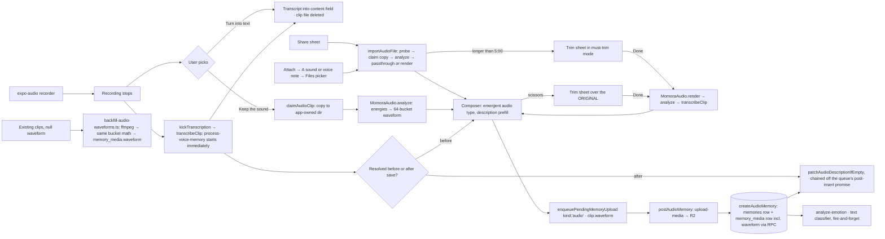

# Feature: Audio memories

**Status:** `done` for v1 — shipped 2026-08-20 (schema + functions deployed, client released via EAS Update to the 1.2.0 runtime, device pass complete incl. caption language/context fixes). **v2 (trim, import, real waveforms): implemented, pending device QA + release** (see [docs/plans/audio-trim-import.md](../plans/audio-trim-import.md); rows marked `[composer — verify]` below describe the composer wiring, which was finished last). Remaining v1 scope lives in the backlog list below and docs/plans/audio-memories-v1.md.
**Last updated:** 2026-10-10 (v2.1: post-save trim on the edit screen; v2: trim, import, real waveforms — implemented, pending device QA + release. 2026-08-20: v1 implementation pass.)
**PRD reference:** §6.3 Memories (new subsection), relates to §6.7 Voice-to-Text Journaling.
**Research basis:** [docs/voice-of-customer.md](../voice-of-customer.md) — §2 theme #6 (legacy/voice), §8 "Voice capture is the emotional wedge" (explicitly recommends revisiting the no-audio-persistence decision), YouGov 47% stat.

## Overview

A fourth first-class memory type: `audio`. Parents record a sound — the child's babble, a mispronounced word, a laugh, a song — and keep the recording itself as the keepsake, with a short AI-generated (user-editable) description shown alongside it. This is distinct from voice **dictation** (see [voice-journaling.md](./voice-journaling.md)), where the parent narrates and the transcript becomes a text memory. Audio memories get their own timeline card and a playback-centered detail experience, preserving the scrapbook feel of the timeline (each memory type looks like a different kind of keepsake) rather than bolting audio onto the `media` carousel.

### Design decisions already made (2026-07-17 discussion)

These were deliberated; don't re-litigate without the maintainer:

1. **One mic, decide after recording.** There is a single recording entry point (the existing composer mic). After the recording stops, the user picks one of two equally-weighted, intent-labeled actions — e.g. **"Turn into text"** vs. **"Keep the sound"**. No upfront taxonomy choice, no "keep the recording?" toggle on the dictation path.
2. **Dictation always transcribes and always discards audio** — unchanged from today. If someone wants to preserve a recording, the answer is always "keep the sound." Exactly one kind of kept audio exists in the product (v2's imported voice notes are that same audio type from a different source, not a second kind).
3. **Description, not transcript, is the visible text.** Audio memories display a short pre-generated description ("Mia singing Twinkle Twinkle in the bath"), editable by the user like a media caption — on the timeline card and the detail screen. The raw transcription is stored **invisibly** for search discoverability only, and is never rendered.
4. **2-minute in-app recording cap** (same as dictation; unchanged in v2). Longer clips risk never being listened to. v2 lets a clip *brought in from outside* run to 5 minutes (see User-facing behavior → Trim and import).
5. **Exclusive type, single clip.** An audio memory holds exactly one clip — no photo/video attachments, no AI illustration toggle. A keepsake sound is singular; an audio carousel is not a thing.
6. **Storage/lifecycle parity with existing media** — same R2 pattern, RLS, account deletion coverage, **and inclusion in the owner archive export**, which has since shipped ([data-export.md](./data-export.md)). The export Worker (`cloudflare/momora-export-worker`) streams `memory_media`-referenced R2 objects into the ZIP; audio clips stored as `memory_media` rows ride that path, but the manifest's asset-kind types must be extended per that doc's extension guide — verify at implementation, don't assume.
7. **Backlog, explicitly not v1:** illustration generated from an audio memory's transcript (the "illustrated memory with voice" combo); "remember my choice" / long-press shortcut at the post-recording fork for heavy dictators; **audio in Looking Back packages** (decided 2026-08-17 — v1 excludes audio memories from package eligibility entirely; v2 designs an audio story frame deliberately, see Constraints & gotchas).

## User-facing behavior

- The composer mic works as today: tap → record (auto-stop at 2 min, with a quiet "Ns left — it stops on its own" heads-up pill in the last 15s) → stop.
- **Post-recording fork** (`VoiceSpeakItModal`, `captureMode: 'fork'` — only in `new-memory.tsx`'s first recording): two equal-weight buttons, outcome-verb labels:
  - **Turn into text** → exactly today's dictation flow: cleaned transcript populates the content field, suggested tags apply, the clip file is deleted. Disabled/dimmed with "couldn't catch the words" if transcription failed — the fork's terminal-failure state — and a note nudges toward keeping the sound instead: "No connection, so the words will have to wait. The sound itself is right here — you can still keep it."
  - **Keep the sound** → the memory becomes an `audio` memory: playable clip chip (inked trace + duration) in the composer, description field pre-filled by AI once it resolves (editable, optional; a shimmer placeholder with "Writing a note from what you said…" and a "write my own note" pencil escape shows while it's still generating), tag picker, date picker. Media attach is inert (disabled camera icon) and the AI illustration toggle is replaced by the hint "Recording again replaces this sound."
  - A quiet tertiary **"Record again"** discards the current clip/transcript and restarts recording, from the fork sheet.
- **Zero-wait fork:** transcription starts the moment recording stops (`useVoiceInput`'s `kickTranscription`, before the user chooses), because both branches need it. Neither branch shows a transcription spinner after a choice whose result is already in hand.
- **Keep-the-sound never depends on transcription succeeding.** If transcription is still in flight (or failed) when the user taps "Keep the sound," the memory saves immediately with an empty description/transcript; if the in-flight call resolves after save, the description/transcript are patched in fire-and-forget (never overwriting text the user already typed — see Constraints).
- **Description fallback:** when the clip is babble/singing and transcription yields nothing usable, the description field is left empty with placeholder copy "Add a note about this sound" — never a garbled machine guess.
- **Clip removal is Undo, not a type flip.** Removing the attached clip pre-save shows "The sound is gone from this memory." with an Undo link and disables Save until it's restored; there is no silent conversion to a text memory.
- **In-composer re-record** (`captureMode: 'keepOnly'`, once the composer already has a kept clip): the toolbar mic re-records with no fork and no "turn into text" option — stopping claims and replaces the attached clip directly, matching the "Recording again replaces this sound" hint.
- **Auto-tagging:** family members mentioned in the transcript pre-select in the tag picker (reuses the existing `mentionedMemberIds` mechanism from dictation, plus the same single-member auto-tag fallback text memories get). Unlimited tags, like `text_only`/`media`.
- **Emotion:** fire-and-forget text-classifier pass over description + transcript after save (same non-blocking pattern as other types), only fired when there's actually something to analyze. No transcript and no description → emotion stays unset (a neutral graphite tint renders everywhere, never a broken/blank state), like video.
- **Timeline card** (`SoundCard` in `memory-card.tsx`): the ticket-stub/inked-trace/wax-seal system — `StubBand` (tinted card-stock panel: seal, trace, mono elapsed/total time, tap-to-seek and drag-to-scrub) + `StubTear` (perforation line with two punched notches painted in the screen background so they read as holes) + description excerpt + engagement bar (share hidden) + the shared `CardFooter` (date, tagged avatars, emotion chip). One inline player at a time app-wide (`audio-playback-coordinator.ts`).
- **Playback visual** (`SoundTrace`, shared by the card, the detail player and the composer chip; v2 draws the clip's **real loudness contour**, see "Real waveforms" below): playback "inks" the recording — un-played trace is a faint pencil line (~24% opacity, thinner), played trace is bold ink with a main→ink gradient over a soft glow in the emotion's main color, and a pen-nib dot (white-rimmed, soft shadow) rides the line at the playhead with a halo that breathes while playing (static when Reduce Motion is on); a brief glow marks playing through to the end. Progress glides on the UI thread (Reanimated): `useAudioClipPlayback` reports every 250 ms and the trace animates linearly between reports at the clip's real rate, snapping only on jumps > 400 ms (seeks). With `onSeek`, a tap seeks and a horizontal drag scrubs (Gesture Handler `Pan`, `activeOffsetX ±6`, fails on vertical movement so list scrolling wins); the host's time label follows the scrub via `onScrubChange`; the trace is an `adjustable` accessibility control (±10%). Static thumbnails (`SoundTile`) pass `showNib={false}`.
- **Detail screen** (`MemoryDetailSound`): playback is the hero (`SoundStage` — large seal, seekable trace, elapsed/total time, status label), then the rest of the standard detail stack (engagement with share disabled, the description when one exists — a note-less memory renders no note block at all (owner decision 2026-08-20; no placeholder copy) — tagged members, date/emotion footer with the emotion-tinted gradient). While playing, the text/engagement block below the player fades to ~32% opacity (words step back). A resolved-but-unreachable clip (bad/expired signed URL) renders "Not on this phone yet" instead of a play control.
- Edit screen: description/tags/date, and **trim** (v2.1, see below). The clip renders recessed with a "Kept as recorded" caption and no remove control; the toolbar mic is disabled with "This sound cannot be re-recorded." (the clip can be cut down, never replaced or re-recorded).
- Calendar day stamps and member-profile thumbnails render a compact `SoundTile` (duration + inked trace) instead of a photo.
- **Copy rules** ([VoC §6](../voice-of-customer.md)): "keep the sound," "record her laugh," "their little voice." Never "audio note," "voice artifact," "audio memo."
- Likes/comments, editing (description, tags, date, and trimming the clip — never replacing or re-recording it), and deletion work like other memory types. Draft autosave never persists the recording (same rationale as media attachments — see [memories.md](./memories.md)); an interrupted composer session keeps text/tags/date only.

### v2: trim, import, real waveforms (implemented 2026-10-10, pending device QA + release)

Plan: [docs/plans/audio-trim-import.md](../plans/audio-trim-import.md). Rows tagged `[composer — verify]` describe composer wiring that was completed last; re-check them against `app/(app)/new-memory.tsx` and `src/hooks/use-composer-audio-clip.ts` before relying on them.

**Trim (composer only, before save).** The composer's clip chip shows a scissors button (`onTrim`, testID `<chip>-trim`; a spinner replaces it while a render runs) when the native module is available and the clip's loudness analysis loaded. It opens `TrimSheet`: the real waveform of the **original** source, two draggable handles (one pan on the whole track grabs the nearest handle within 44 pt; each handle is also an `adjustable` accessibility element, ±0.5 s), the kept part highlighted, start/length/end labels, a play-the-selection preview, **Reset**, **Cancel**, **Done**.
- **Constraints:** selection ≥ 1 s; ≤ 2:00 for a recorded clip, ≤ 5:00 for an imported one (Done is disabled and the sheet says "Keep up to 5 minutes" otherwise).
- **Suggested "quiet bits" trim:** on open, `suggestTrim` pre-applies a cut when the clip has dead air at either end (anything > 35 dB below the loudest bucket, padded by 250 ms; offered only if it removes ≥ 600 ms and leaves ≥ 1 s). The sheet says "We trimmed the quiet bits. Drag to adjust." until the parent touches a handle.
- **Reset** only moves the handles back to the full range of the original; it never swaps files. A **Done with the full range** on an uploadable original (a recorded clip, or an AAC/MP4 import that passed through) makes the original the clip again: no render, no new transcription call. Any other Done renders `[startMs, endMs)` of the **original** (never of a previous trim, so repeated trims don't compound generation loss), re-analyzes the result for its waveform, and re-transcribes it. `[composer — verify]`
- **While a render runs** the chip shows a spinner, **Save and the toolbar mic are disabled**, and Cancel/back marks the session abandoned so the render's completion discards its own output. The note field stays editable. `[composer — verify]`
- **The note:** an untouched AI caption is replaced by the one for the trimmed clip; text the parent typed or edited is never overwritten (the sheet says "Your note stays as you wrote it." when one exists). The old transcript is cleared first, so a failed re-transcription saves `audio_transcript: null` rather than the full clip's words. `[composer — verify]`
- **Trim is a keepsake edit, not a privacy guarantee:** the full clip was already sent for transcription the moment recording stopped (the zero-wait fork). Only the trimmed audio is **stored** (R2, export, year film).

**Import (a voice note from outside).** Two entry points, both ending in the same composer clip (`source: 'imported'`):
1. **Attach menu → "A sound or voice note"** (`MemoryMediaPicker`'s `onPickSound`; shown only while no photos/videos are attached, no clip exists, and both the native module and `expo-document-picker` are present). Opens `BringInSoundSheet`: primary **"Choose from Files"** (system picker, `audio/*` + Ogg types), and a short guide: *From WhatsApp — Press and hold the voice note → Forward → tap the share button (bottom right) → Momora*; *From Voice Memos — Tap ⋯ on the recording → Share → Momora*. On Android the attach menu is the three actions only (Alert allows three buttons), dismissed by tapping outside. The compact button's accessibility label becomes "Attach photo, video, or sound". `[composer — verify]` for the wiring; the sheet and menu are covered by their own component tests.
2. **Share sheet** ("Share → Momora"): iOS accepts up to 10 images/movies **or exactly one** audio attachment; Android accepts a single `audio/*` or `application/ogg` share. A payload counts as a voice note when `contentType === 'audio'` or it is a generic `file` whose extension/mime is in the audio list (`opus, ogg, oga, m4a, mp3, wav, caf, amr, aac, aiff`), because Android maps `application/ogg` to `file` and iOS can route a `.opus` as `application/octet-stream`; the native `probe` makes the final call.
- **Length rules:** up to **5:00** is accepted as-is (an AAC/MP4 file ≤ 4.5 MB passes through untouched; anything else is re-encoded to 96 kbps mono AAC, ≈ 3.6 MB for 5 min). A source longer than 5:00 opens the trim sheet in **must-trim** mode ("Choose up to 5 minutes to keep"; Done stays disabled until the selection is ≤ 5:00; Cancel abandons the import and discards the files). A source over **30 minutes** (or 200 MB) is refused: "That recording is longer than 30 minutes." The in-app recording cap stays 2:00.
- **Errors:** unsupported file → "Momora can't open this kind of sound file yet." (iOS Ogg from the picker adds "In WhatsApp, use Forward → Share → Momora instead."); other failures → "Couldn't open that sound. Try again."; an older binary without the module → "Update Momora to bring in voice notes."
- **Date:** the suggested memory date is taken from the WhatsApp file name (`AUDIO-YYYY-MM-DD-HH-MM-SS` on iOS, `PTT-`/`AUD-YYYYMMDD-WA####` on Android — the name carries the **send** time), else the container's creation date but only if it is more than 15 minutes old (WhatsApp stamps the export time there), else no suggestion; never a future date. It is applied as a *suggestion* (`useSuggestedMemoryDate`'s `audioCapturedAtIso`, `dateSource: 'media'`, `suggestionKind: 'audio'`, visible label "From the voice note" with the accessibility hint "Suggested from the voice note's date"), never as a user edit, so the parent can still change it and clearing the clip clears it. `[composer — verify]`
- **Imports are usually someone else's voice** (grandma's "I miss you"): the transcription call sends `speaker: 'unknown'` so first-person words never auto-tag the parent. The generating placeholder reads "Writing a note about this sound…" and `memory_saved.used_voice` is false. `[composer — verify]`
- **Mutual exclusion (an audio memory is a single clip with no photos/videos):** a voice note shared/picked while photos are attached is refused ("This memory already has photos. Save it first, then share the voice note."); photos shared while a clip exists are refused ("This memory is a sound. Save it first, then share photos."); a voice note shared while a clip exists **replaces** it through the same keep logic as "Recording again replaces this sound" (the current clip, its original and any superseded renders are discarded; a typed note survives). Audio mixed with photos in one share → "Share one voice note at a time, or photos and videos together." `[composer — verify]`

**Real waveforms.** Every audio surface draws the clip's real loudness contour (64 buckets, normalized to the loudest bucket, floor so silence still draws a thin line) instead of the seeded decorative line: timeline card, detail player, composer chip, fork modal (analyzed right after stop), calendar day stamp, member thumbnail, pending-upload card, the edit screen's clip well, and the trim sheet. **Exception:** `memory-fallback-tile.tsx` (activity drawer, search rows, year-film moments grid) never receives `memory_media` rows and stays decorative. A clip with no stored waveform (recorded on an old binary, analysis timed out, native failure, or not yet backfilled) falls back to the seeded line; `undefined` (rows from a persisted TanStack cache older than the column) is treated like `null`.

## Architecture



**v2 additions.** The native `momora-audio` module only decodes and measures (`probe`, `analyze`, `render`); every dB/normalization decision lives in one TypeScript file (`src/utils/audio-waveform.ts`) that the app and the backfill script share. An import is claimed into `audio-recordings/` the moment it is picked, so the same custody/sweep rules cover it; trims always render from the **original** (the pre-trim source), and the original is kept for the whole composer session so Reset and re-trim cost nothing. A trim or import completion re-enters the composer through the same keep logic as a fresh recording (typed-note ratchet, generation token, identity-guarded transcription), so a late result can never clobber the parent's text or a newer clip. The waveform travels with the clip: composer state → `enqueuePendingMemoryUpload` (`clip.waveform`, also drawn by the pending card) → `postAudioMemory` → `createAudioMemory` → `replace_memory_media_assets`.

Save order follows the house rule: `enqueuePendingMemoryUpload` admits the memory into the deferred-posting queue synchronously (composer closes immediately); the clip upload + `memories`/`memory_media` row insert happen in the background via `postAudioMemory`/`createAudioMemory`. Description/transcript backfill and emotion analysis never block save and never block each other. If transcription is still in flight at save time, its promise is handed through the queue (`PostAudioMemoryInput.pendingTranscription`) so the backfill fires only after the row actually exists — see Constraints for why a caller-side chain off the raw promise would silently lose the race.

## Data model (shipped — `supabase/migrations/20260819120000_audio_memories.sql`)

| Table / field | Role |
|---------------|------|
| `memories.memory_type` | `text_illustration` \| `text_only` \| `media` \| `audio` (widened check constraint) |
| `memories.content` | The visible, editable description — nullable, normalized empty/whitespace → `NULL` (never `''`) on write. Searchable via the existing FTS index on `content` for free |
| `memories.audio_transcript` | Invisible raw transcript, nullable; same empty→`NULL` normalization. Own GIN index (`idx_memories_audio_transcript_search`, `to_tsvector('english', audio_transcript)`) — `searchMemories` runs it as a second query merged + deduped client-side alongside the `content` and emotion-label queries (same established pattern), not a combined tsvector |
| `memories.media_key` / `media_content_type` | Mirror the single clip (non-null, like `media`'s cover cache) |
| `memories.illustration_key` / `illustration_status` | Null / `'none'` (until the backlog illustration combo) |
| `memory_media` (exactly one row) | The clip: `content_type` one of `audio/mp4`, `audio/m4a`, `audio/x-m4a`; `duration_ms` populated (reused existing column, no new column); `preview_object_key` stays null (no preview concept); **`waveform smallint[]`** (v2, below) |
| `memory_media.waveform` (v2) | The clip's real loudness contour: 16–256 integer buckets, each 0–255 (the app always writes exactly 64). `NULL` = unknown, the UI draws the seeded line. Always `NULL` for image/video rows |

**`memories_type_invariants`** gained a fourth arm (superseding the version in `20260801170000_paid_subscription_sol_hardening.sql`): `memory_type = 'audio' AND media_key IS NOT NULL AND media_content_type IS NOT NULL AND illustration_status = 'none'` — `content` is deliberately left unconstrained (nullable *and* permitted non-null) rather than forbidden, because an old-build edit screen can still staple a caption onto an audio row post-migration; a content-forbidding arm would turn that save into a raw Postgres error instead of a normal write.

**Two new triggers, both on `memory_media`/`memories` (not the `memories` insert path):**
- `memory_media_audio_invariants` (before insert/update of `content_type, memory_id` on `memory_media`) enforces **at most one** `memory_media` row per `audio` parent, audio content types only under `audio` parents, and non-audio content types forbidden under an `audio` parent. "At most one," not "exactly one," because the memory row → tags → `replace_memory_media_assets` insert order means every audio memory transiently has zero media rows between its own insert and the clip row landing — the same legal transient state `media` already tolerates (and the reason the realtime retry gate exists, see below).
- `memories_audio_type_immutable` (before update of `memory_type` on `memories`) rejects any transition where either side of the update is `'audio'`. Mirrored at the app level by `updateMemory`'s explicit guard (`src/services/memories.ts`) for a friendlier error than a raw `23514`.

**v2 waveform column (migration `20261013120000_memory_media_waveform.sql`).** `alter table memory_media add column waveform smallint[]` with CHECK `memory_media_waveform_valid` (`null` or cardinality 16–256, no NULL elements via `array_position(waveform, null) is null`, every element 0–255). The `array_position` term is load-bearing: `0 <= all(waveform)` evaluates to NULL — which a CHECK treats as passing — when an element is NULL. The CHECK, not "RPC-only writes", is the real guard, because `authenticated` holds a table-level UPDATE grant on `memory_media` gated only by RLS. `replace_memory_media_assets` was recreated from `20260820100000_audio_memory_media_rpc.sql` with every existing check, `security definer` and the grants unchanged, and:
- reads `asset->'waveform'` and stores it **only for audio content types** (ignored on image/video assets);
- **never raises for a bad waveform**: a non-array, wrong length, non-integer, out-of-range value or `null` element (what `NaN` becomes after JSON serialization) is stored as `NULL` and the save succeeds. The field is cosmetic and the upload queue retries an identical payload forever, so raising would permanently fail a child's clip save over a decoration (the client sanitises first with `sanitizeWaveform`; this is the second guard);
- **preserves by key**: when the payload's waveform is absent/`null` and `object_key` matches an existing row, that row's waveform is kept (`existing_waveforms` jsonb map, same pattern as `aspect_ratio`/`preview_object_key`), so an old client re-saving an unchanged clip cannot erase the contour. An invalid non-null value is *not* preserved over; it stores `NULL`.
No RLS change. Client types: `MemoryMediaAsset.waveform: number[] | null` (readers use `asset.waveform ?? null`), `MemoryMediaAssetInput.waveform?`, `mediaAssetsToRpcPayload` passes `sanitizeWaveform(asset.waveform)`. Existing rows are filled by the backfill (below). Canonical schema/RPC text: [TECH_SPEC.md](../TECH_SPEC.md) §2.1 and the `replace_memory_media_assets` contract in §5.5.

**Why `memory_media` and not a new `audio_key` column:** a single `memory_media` row rides everything already built for media keys — the `upload-media` allow-list, `parseStorageKey`/family-access resolution, RLS, and `hard-delete-expired-accounts`'s key collection — instead of teaching every storage-key surface a new column. See [media-memories.md](./media-memories.md) Constraints for the list of surfaces that break when a key column is added without full coverage.

**R2 key pattern:** the client always uploads a new clip through the per-asset pattern — `{userId}/memories/{memoryId}/media/{mediaAssetId}.m4a` — via `buildMemoryMediaAssetKey`. `_shared/storage-keys.ts` widens all four allow-list surfaces for audio: `MEMORY_MEDIA_CONTENT_TYPES` (the content-type set), `MEMORY_MEDIA_EXTENSION_PATTERN`/`MEMORY_MEDIA_ASSET_EXTENSION_PATTERN` (key-shape validation), and `MEMORY_MEDIA_FULL_PATTERN`/`MEMORY_MEDIA_ASSET_FULL_PATTERN` (feed `parseStorageKey`, which `_shared/family-access.ts` uses to resolve a key's owning family for read authorization — missing these would make an uploaded clip unplayable, not just unuploadable). The legacy single-object `{userId}/memories/{memoryId}/media.{ext}` pattern also accepts `m4a` but the client never writes audio through it.

**RLS / deletion / export parity:** family-scoped `memories`/`memory_media` policies cover audio with no new policy. Account deletion picks the clip up via `memory_media.object_key` collection (MIME-agnostic). Export ([data-export.md](./data-export.md)): the export Worker iterates `memory_media` rows type-agnostically and derives extensions from the object key, so an audio clip rides the existing path with no Worker code change (covering test only, per the plan's P1.5). Looking Back eligibility (`get_or_create_looking_back_packages`) excludes `memory_type <> 'audio'` in both of its candidate-selection predicates — v1 audio memories never enter package eligibility.

## API & Edge Functions (shipped; v2 additions marked)

| Function | Change | Auth |
|----------|--------|------|
| `process-voice-memory` | Family mode's cleanup call (`gpt-4o-mini`) now returns `description` alongside `cleanedText`/`mentionedMemberIds` on every response — one round trip serves both fork branches. `description` is server-sanitized (trimmed, clamped to 120 chars, `''` when speech is unusable — never an error, never garbled babble). Onboarding mode's response is unchanged (no `description` field; the fork does not exist pre-auth) | JWT |
| `process-voice-memory` (v2 request field) | Family mode accepts an optional `speaker?: 'unknown'` (sent by the client for **imported** voice notes). It skips the `mentionedUserSelf` → caller's-own-member mapping, so "I miss you" in grandma's voice note never auto-tags the parent; name/nickname matches are unaffected. Absent = today's behavior (the speaker is the caller). Any other value → `400 validation_error` ("speaker is invalid"); `mode: 'onboarding'` rejects the field ("Onboarding voice cannot include speaker") before any reservation or provider call. The server's size check is untouched (`bytes / 16000 > 120` → `AUDIO_TOO_LONG`), which is why the client sends an excerpt for long clips (below). **Deploy this function before the store build** | JWT |
| `upload-media` | Adds `audio/mp4`, `audio/m4a`, `audio/x-m4a` to its content-type allow-list (via `_shared/storage-keys.ts#MEMORY_MEDIA_CONTENT_TYPES`) and a dedicated **5 MB** cap for those types (`maxBytesForContentType`) — generous headroom over the ~1.9 MB a 2-minute AAC clip actually produces at `expo-audio`'s `HIGH_QUALITY` preset, and over the ~3.6 MB a 5-minute v2 import/trim produces at 96 kbps mono (unchanged in v2; the client also refuses a passthrough import above 4.5 MB) | JWT |
| `get-media-url` | No change — presigns the clip for playback like any media key | JWT |
| `analyze-emotion` | New `memory_type === 'audio'` branch: classifies over `content` (description) + `audio_transcript` via the same text-classifier path as `text_only`, dispatched by `buildAudioEmotionClassifierInput`. Either field alone is enough to proceed; both empty (babble/silence with no typed caption) returns `{ emotion: '', colorPalette: '', skipped: true }` — success-shaped, never an error, same spirit as a video memory with nothing to analyze | JWT |
| `compose-share-card` | Unchanged: still **rejects `audio` explicitly** with `400 unsupported_memory_type` (`isRejectedMemoryType`). The client never reaches it for audio — `enableShare={false}` on the audio card/detail engagement bar hides the affordance, and `warmShareCardForMemoryFireAndForget` returns early for `memory_type === 'audio'` before ever warming | JWT |

Full request/response shapes and the widened schema live in [TECH_SPEC.md](../TECH_SPEC.md) §2/§4.

**Transcription excerpt rule (v2).** `transcribeClip(uri, members, familyId, { speaker?, durationMs?, sizeBytes? })` in `src/services/voice-transcription.ts` is the pure body of what `useVoiceInput.kickTranscription` used to do inline (the hook now calls it; behavior unchanged). Because the server estimates duration from **bytes** assuming 128 kbps, a clip is first cut to an **excerpt** when `durationMs > 115 s` **or** `sizeBytes > 1,750,000` (looked up from the file when not supplied): `MomoraAudio.render` writes the first ≤ 115 s at 64 kbps (≤ ~0.92 MB) into `audio-recordings/` (so a force-quit leaves it to the 48 h sweep), that excerpt is what is transcribed, and it is deleted in a `finally`. Fresh recordings near the 2-minute cap (128 kbps ≈ 1.9 MB) can also take this path; fine. When the native module is unavailable, or the excerpt render fails, the whole file is sent (today's behavior). Consequences: for a long clip the description is generated from its opening ~115 s, and the invisible search transcript covers only that excerpt (accepted).

**AI usage ledger:** `description` generation rides the SAME `voice_cleanup` operation/ledger write as the existing cleanup call — one `chatJson` call now returns both `cleanedText` and `description`, so no new `ai_usage_events` `operation` value was needed (the plan's "extend the enum" option was not taken; the "record as `voice_cleanup`" option was). Ledger writes stay fire-and-forget, family-attributed, never blocking. The **image** fair-use caps don't apply (audio has no image generation); no new visible or invisible limit exists for v1 — transcription/cleanup cost is bounded by the 2-minute cap and capture friction, same as dictation always was.

#### v2.1: trim a saved sound (implemented 2026-10-10, pending device QA + release)

Plan: the "Addendum: post-save trim" section of [docs/plans/audio-trim-import.md](../plans/audio-trim-import.md). Owner decisions (don't re-litigate): trimming a saved sound is **permanent**, the **note is kept as is**, **whoever can edit the memory can trim** (`canEditFamilyContent`), **online only**. No migration.

- **Where:** the edit screen's recessed clip chip gets the scissors only when `MomoraAudio.isAvailable()` (older binaries: no button, no crash), the user can edit, and the device is online. If the tap lands offline (or connectivity drops mid-download): "Trimming needs a connection." A failed/expired download: "Couldn't load this sound. Try again." A failed render: "Couldn't trim that sound. Try again."
- **Flow:** tap → chip spinner → the saved clip (signed URL) is downloaded to `audio-recordings/` → `analyze` → `TrimSheet` (300 s selection cap, `mustTrim` false, suggested range from `suggestTrim` when there is no pending trim, `hasUserNote` = note non-empty). The downloaded file is the session's *original*; the sheet always edits relative to it and reopens at the pending range. Done with the **full range** clears any pending trim; otherwise the cut is rendered (96 kbps) and analyzed and held as a **pending trim** — the chip plays the local render with its real waveform/duration and the caption reads "Trimmed — saves when you tap Save". Nothing is uploaded or written until Save. Save is disabled while downloading/rendering.
- **Save:** with a pending trim, Save first asks "Trim this sound?" / "The part you cut will be gone for good." (Cancel / "Trim and save"). Confirmed → `useMemoryMutations().updateMemory({ …, audioClip: { fileUri, durationMs, waveform } })`: the `.m4a` goes up through `uploadAudioClipObject` (the audio path shared with `postAudioMemory`; **never** `uploadMemoryMediaAssets`, whose EXIF-strip/compression would break on audio) under a fresh asset id, its key is pushed to `uploadedKeys` (deleted again if `updateMemory` fails), then `updateMemory` receives `mediaAssets: [{ objectKey, contentType: 'audio/mp4', durationMs, waveform }]` and `audioTranscript: null`. A save without a pending trim is exactly the old description/tags/date save.
- **`updateMemory` rules:** `mediaAssets` is accepted for `memoryType === 'audio'` only as **exactly one** `audio/mp4|m4a|x-m4a` asset (`validateAudioReplacementAssets`); anything else keeps the `invalid_memory_type` error. `UpdateMemoryInput.audioTranscript` (audio only, `''`/whitespace → `NULL`) is written in its own `memories` update **after the clip replace succeeds** — the old transcript describes parts that are now gone, but a failed RPC must leave the still-current clip's transcript intact (a failure of that late write is returned like the other writes). The pre-existing removed-key cleanup after `replace_memory_media_assets` deletes the old R2 object (and its share-card key) once the RPC succeeded; on RPC failure nothing is deleted.
- **After a successful save:** fire-and-forget `transcribeClip(render, members, familyId, { durationMs, sizeBytes })` → `patchAudioDescriptionIfEmpty(memoryId, { description, transcript })` (the description fills only an *empty* note; the hidden transcript is always rewritten). The local files (downloaded original + render) are deleted only after transcription settles — it reads the render. Navigation never waits for it. Leaving the screen without saving (Cancel/back/unmount) deletes both files; a late download/render that finishes after leaving discards its own output (generation token in `useSavedAudioTrim`).
- **Side effects (no code change):** Year Films referencing the old key are invalidated by the `year_films_on_memory_media_deleted` trigger (they re-render); book QR codes resolve the current clip live via `workers/memory-viewer`; other devices refresh via `updated_at`.
- **Analytics:** `audio_trim_opened { source: 'saved', suggested }`, `audio_trim_applied { source: 'saved', removed_bucket }` (fired on successful save).
- **Cost:** one `process-voice-memory` call per saved trim (the backfill transcription), like a composer trim.

**AI cost, v2.** Every **trim Done that is not a full-range restore** costs one more `process-voice-memory` call (transcription + cleanup, the same `voice_cleanup` ledger operation), because the cut changes what was said; a full-range Done restores the original's cached result for free. Every **import** costs one call, up to 5 minutes of source audio but at most a ~115 s excerpt is actually transcribed. Parents can chain trims, so the per-memory cost is no longer fixed at one call; there is still no new limit — the cost is bounded by human effort per trim and by the excerpt rule, and `ai_usage_events` attribution is unchanged.

**Transport note:** dictation's base64-through-edge-function path stays the transport for transcription at the 2-min cap (~1–2 MB AAC) — unchanged; v2 keeps every transcription payload under that size via the excerpt rule above. The **kept clip** uploads through the `upload-media` proxy path (`postAudioMemory` → `uploadMediaObject`), same as other media; it is never round-tripped as base64 through an Edge Function.

## Client integration (shipped; v2 rows marked)

| Layer | Files | Responsibility |
|-------|-------|----------------|
| Routes | `app/(app)/new-memory.tsx` | Post-recording fork state (`audioClip`/`audioClipRemoved`/`audioTranscript`), emergent `audio` composer, `handleSaveAudio` |
| Routes | `app/(app)/memory/[id]/index.tsx` | `MemoryDetailSound`/`SoundStage` — playback-hero detail variant, "Not on this phone yet" unavailable state |
| Routes | `app/(app)/memory/[id]/edit.tsx` | Recessed clip well, description/tags/date edit, disabled re-record mic; *(v2.1)* scissors → `TrimSheet`, pending-trim preview, confirm-on-Save, post-save transcription backfill |
| Routes / components | `src/components/memory-stamp.tsx` (Timeline calendar view tiles), `app/(app)/family/[id]/index.tsx` | `SoundTile` day-stamp / member-thumb variants |
| Hooks | `src/hooks/useVoiceInput.ts` | Recording + immediate `kickTranscription`, stale-response guarding via `activeClipUriRef`, exposes `transcriptionPromise` for post-close awaiting |
| Hooks | `src/hooks/useAudioClipPlayback.ts` | Per-clip `expo-audio` playback state (create-once + `replace()`, never `expo-av`) |
| Hooks | `src/hooks/audio-playback-coordinator.ts` | Module-level "one sound plays app-wide" singleton (`useSyncExternalStore`); exports `pauseAllAudioPlayback`/`prepareAudioPlaybackMode` for future callers — recorder start and video autoplay are **not yet wired** to it (see Extension guide) |
| Hooks | `src/hooks/useMemories.ts`, `useMemoriesRealtime.ts` | `runAudioEmotionAnalysis` wrapper; realtime INSERT retry gate extended to `audio` alongside `media` |
| Utils | `src/utils/audio-clip-custody.ts` | `claimAudioClip` (temp → app-owned `audio-recordings/` dir), `discardAudioClip`, `sweepAudioRecordingsDirectory` (48h startup sweep, wired in `app-providers.tsx`) |
| Services | `src/services/memories.ts` | `createAudioMemory`, `resolveAudioMemoryInsertConflict`, `patchAudioDescriptionIfEmpty`, `runAudioEmotionAnalysis`, audio-aware `updateMemory` type-immutability guard, `audio_transcript` merged into `searchMemories` |
| Services | `src/services/memory-posting.ts` | `postAudioMemory` (dedicated minimal upload pipeline — no compression/EXIF-strip/preview), `PostAudioMemoryInput`, `isAudioUploadInput` |
| Services | `src/services/share-card.ts` | `warmShareCardForMemoryFireAndForget` skips `audio` entirely |
| Components | `src/components/voice-speak-it-modal.tsx` | `VoiceCaptureMode` (`'dictate' \| 'fork' \| 'keepOnly'`), the fork UI, "Record again" |
| Components | `src/components/memory-card.tsx` | `SoundCard` variant + the forward-compat `UnknownTypeCard` (P0.1 defensive patch, see Constraints) |
| Components | `src/components/pending-memory-upload-card.tsx` | Audio-specific pending/failed copy, `SoundTile` preview |
| Components | `src/components/audio/` (new kit) | `clip-chip.tsx` (composer/edit clip row), `sound-tile.tsx` (`SoundTile` + `SoundMark`), `sound-trace.tsx` (deterministic seeded "inked waveform"), `listen-seal.tsx` (play/pause wax-seal control), `stub-band.tsx` + `stub-tear.tsx` (timeline card visual + ticket-tear), `audio-emotion.ts` (`resolveAudioEmotionColors`, the neutral pre-emotion tint, `formatClipTime`), `audio-seed.ts` (`seedFromKey`, deterministic per-clip trace seed) |
| Hooks (client wrapper) | `src/services/ai.ts` | `processVoiceMemory` return type includes `description`; v2 adds the optional `{ speaker: 'unknown' }` option, sent only when set |
| **v2 — native module** | `modules/momora-audio/**` | Local Expo module (autolinked from `modules/`, imported by relative path, no root `package.json` entry — same as `momora-widget`). `src/index.ts` wraps it: `isAvailable()`, `probe`, `analyze`, `render`, `MomoraAudioError`. iOS: `ios/MomoraAudioModule.swift` (thin Expo wrapper) over Expo-free core files `AudioDecoder.swift` (the `PCMSource` protocol + `AudioDecoder.openSource`), `AudioProbe.swift`, `AudioAnalysis.swift`, `AudioRender.swift` (AAC writer), `AudioErrors.swift`. Android: `MomoraAudioModule.kt`, `AudioOperations.kt`, `AudioInput.kt`, `PcmDecoder.kt` (MediaExtractor + MediaCodec), `AacM4aWriter.kt` (MediaCodec + MediaMuxer), `LinearResampler.kt`, `AudioErrors.kt`. `scripts/verify-macos.sh` + `cli-main.swift` are the iOS regression harness. See "Native module" below |
| v2 — waveform math | `src/utils/audio-waveform.ts` (+ `__fixtures__/waveform-golden.json`) | The ONE implementation of loudness math: `WAVEFORM_BUCKETS = 64`, `energiesFromPcm` (TS reference for the native bucketing), `waveformFromEnergies`, `suggestTrim`, `envelopeForTrace`, `sanitizeWaveform`, `synthesizeFromRecipe`. No `@/` or React Native imports (Deno-importable by the backfill) |
| v2 — import helpers | `src/utils/voice-note-date.ts`, `src/utils/document-picker.ts`, `src/utils/prepare-shared-media.ts`, `src/utils/media-validation.ts` | `parseVoiceNoteDate`/`pickImportedMemoryDate`; the OTA-safe lazy `expo-document-picker` wrapper (`isDocumentPickerAvailable`, `pickAudioDocument`); `prepareSharedMedia`'s discriminated result (`media` \| `audio` \| `error`) and audio classification; the split caps `MAX_RECORDING_DURATION_MS` (2 min, documentary) and `MAX_AUDIO_UPLOAD_DURATION_MS` (5 min + 1 s, what `assertAudioClipWithinLimits` enforces) |
| v2 — custody | `src/utils/audio-clip-custody.ts` | Adds `newAudioRecordingUri(ext)` (every file Momora writes there is named `<claimEpochMs>-<uuid>.<ext>`), `isInsideAudioRecordingsDirectory`; the sweep reads the age from the name (a copied import can keep a month-old mtime) and falls back to mtime for legacy `<uuid>.m4a` names |
| v2 — services | `src/services/audio-import.ts`, `src/services/voice-transcription.ts` | `importAudioFile` (never opens UI; returns `clip` \| `needsTrim` \| `error`); `transcribeClip` (+ excerpt rule) |
| v2 — hooks | `src/hooks/use-incoming-memory-share.ts`, `src/hooks/use-suggested-memory-date.ts`, `src/hooks/useAudioClipPlayback.ts`, `src/hooks/use-pending-memory-uploads.tsx` | Share hook reports the discriminated `PrepareSharedMediaResult`; date hook takes `audioCapturedAtIso` and returns `suggestionKind`; playback gains `playRange(start, end)` + `pause()` (stop is driven by 250 ms status updates, so a preview can overshoot the end handle by ~250 ms); `PendingMemoryUpload.previewWaveform` |
| v2 — components | `src/components/audio/trim-sheet.tsx`, `bring-in-sound-sheet.tsx`, `clip-chip.tsx`, `sound-trace.tsx`, `src/components/memory-media-picker.tsx` | `TrimSheet` (RN `Modal` with its own `GestureHandlerRootView`); `BringInSoundSheet` (reports dismissal via `onDismissed` for the picker hand-off); `ClipChip` `onTrim` + `processing`; `SoundTrace` `waveform` prop (null/absent → seeded `moEnv`); `MemoryMediaPicker` `onPickSound` |
| v2 — composer `[composer — verify]` | `app/(app)/new-memory.tsx`, `src/hooks/use-composer-audio-clip.ts`, `src/components/voice-speak-it-modal.tsx` | The composer's `audioClip` state (`localUri`, `durationMs`, `waveform`, `source`, `original{…}`, `trimmed`), the keep/trim/import state machine (`applyKeptClip`, generation token `audioOpGenerationRef`, `SAVE_ANALYSIS_WAIT_MS = 1500`) lives in `use-composer-audio-clip.ts`; `new-memory.tsx` mounts `TrimSheet` (`new-memory-trim-sheet`) and `BringInSoundSheet` (`new-memory-bring-in-sound`); the fork modal analyzes the stopped clip for a real waveform |
| v2.1 — post-save trim | `src/hooks/use-saved-audio-trim.ts`, `src/hooks/useMemories.ts` (`updateMutation` `audioClip`), `src/services/memory-posting.ts` (`uploadAudioClipObject`), `src/services/memories.ts` (`updateMemory` audio asset replace + `audioTranscript`), `src/utils/memories.ts` (`validateAudioReplacementAssets`, `UpdateMemoryInput.audioTranscript`) | `useSavedAudioTrim` owns the local-file side (download → analyze → sheet → render → pending trim; generation token; file custody; `handOffFiles` after a successful save); the mutation uploads via the audio helper and rolls the key back on failure; `updateMemory` replaces the single clip |
| v2 — backend | `supabase/migrations/20261013120000_memory_media_waveform.sql`, `supabase/functions/process-voice-memory/index.ts`, `supabase/scripts/backfill-audio-waveforms.ts` | Column + RPC; `speaker` field; backfill |
| v2 — config | `app.json`, `package.json` | `expo-sharing` iOS `activationRule` (string predicate) + Android `singleShareMimeTypes` (`audio/*`, `application/ogg`); `expo-document-picker` dependency; `backfill:audio-waveforms` script |

### Native module `momora-audio` (v2)

A deliberately small, "dumb" surface — it decodes and measures; it does not decide anything about loudness.

```ts
isAvailable(): boolean                       // requireOptionalNativeModule('MomoraAudio') != null
probe(uri): Promise<AudioProbe>              // cheap metadata: durationMs, container, codec, sampleRate, channels, creationDate|null, sizeBytes
analyze(uri, { maxBuckets, minBucketMs }): Promise<AudioEnergies>   // { durationMs, bucketMs, energies[] } mean-square per bucket
render(uri, { startMs, endMs, outputUri, bitrate }): Promise<RenderResult>   // { uri, durationMs, sizeBytes }; AAC-LC mono 48 kHz .m4a
```

- **Error codes** (stable strings on `error.code`, wrapped as `MomoraAudioError`): `unsupported_format`, `decode_failed`, `too_long` (> 30 minutes), `io_failed` — produced identically by iOS and Android — plus `unavailable`, produced only by the TS wrapper when the native module is absent. Messages never contain file names or paths (voice notes of children are PII). `probe` does not enforce the 30-minute ceiling (the caller needs the duration to show the right message); `analyze` and `render` do.
- **Energy bucket spec — identical in Swift, Kotlin, TS (`energiesFromPcm`) and the backfill.** Mono downmix = arithmetic mean of channels, Float32 in [-1, 1]. `bucketMs = max(minBucketMs, ceil(durationMsEstimate / maxBuckets))` (integer ms; the estimate is container metadata). `samplesPerBucket = max(1, round(bucketMs * sampleRate / 1000))` at the **decoded** sample rate (no resampling for analysis). Bucket `i` covers `[i*spb, min((i+1)*spb, n))`; `energies[i] = mean(x²)` over its own samples (the last bucket may be partial). `durationMs = round(n * 1000 / sampleRate)` — the decoded length, which is the value the app trusts (recorder `durationMillis` updates every 500 ms and can be ~0.5 s short). Because the bucket size is derived from a metadata estimate, `energies.length` can exceed `maxBuckets` by a bucket or two; every consumer reads the returned `bucketMs` and never recomputes it. The app calls `analyze(uri, { maxBuckets: 4000, minBucketMs: 20 })`.
- **`render`** decodes only `[startMs, endMs)`, streams ~1 s chunks (a 30-minute source is ~170 MB of float PCM, so nothing holds the whole file), resamples to 48 kHz, and encodes AAC-LC mono. Clips use 96 kbps; transcription excerpts use 64 kbps. Partial output is deleted on failure. iOS writes through `AVAssetWriter` (proper priming/edit list); Android uses `MediaCodec` + `MediaMuxer` with a streaming linear resampler. All work runs off the JS thread (a dedicated concurrent queue on iOS, `Dispatchers.IO` on Android).
- **Format coverage.** iOS: whatever `AVAudioFile` reads (AAC/ALAC `.m4a`, caf incl. Opus-in-CAF, wav, aiff, mp3, amr); container detection is by magic bytes, never extension. **Ogg Opus is refused on iOS for now** (`unsupported_format`; `probe` still reads an Ogg file's channels and length so the app can show a precise message). Android: `MediaExtractor` + `MediaCodec`; Ogg Opus works where the platform extractor opens it, and where it can't (API 24–28 to be confirmed in device QA) the clip surfaces as `unsupported_format` — there is no special path.
- **OTA safety.** `requireOptionalNativeModule('MomoraAudio')` is resolved per call, not at import, so JS shipped by OTA to a 1.4.x binary without the module degrades cleanly: no trim button, no "A sound or voice note" option, audio shares refused with "Update Momora to bring in voice notes.", recorded clips save with `waveform: null`, transcription sends the whole file as before. `expo-document-picker` is likewise never statically imported — `src/utils/document-picker.ts` checks `requireOptionalNativeModule('ExpoDocumentPicker')` before a lazy `require`. Do not use `src/lib/sentry.ts`'s `NativeModules` check for Expo modules; it would always report them missing. The store build that contains both modules is **1.5.0** (the `app.json` version bump happens at release; it is still 1.4.3 in the tree).
- **Regression harness (iOS).** `modules/momora-audio/scripts/verify-macos.sh` compiles the Expo-free iOS core files with `scripts/cli-main.swift` for macOS (and optionally the iOS simulator), generates **synthetic** inputs with ffmpeg `lavfi` (tones/noise/silence only — the repo is public, so no human voices) in m4a/wav/caf/aiff/mp3 plus an Ogg Opus that must be refused, and checks probe/analyze/render durations, energies against an independent Python implementation of the bucket spec, render output (AAC-LC, mono, 48 kHz, right length, time-aligned), and the stable error codes (172 checks at last run). Requires macOS, Xcode and ffmpeg; not in CI. Run it after touching `modules/momora-audio/ios/*`. It does not read `waveform-golden.json` (that fixture is consumed by the Jest test and the Deno backfill test).

### Waveform backfill (v2)

`supabase/scripts/backfill-audio-waveforms.ts` (`npm run backfill:audio-waveforms`) fills `memory_media.waveform` for audio rows where it is `NULL`: presigned R2 GET → temp file → `ffmpeg -ac 1 -ar 48000 -f f32le -` → `energiesFromPcm` (same 4000/20 parameters as the app) → `waveformFromEnergies` → `sanitizeWaveform` → `update … where id = … and waveform is null`. All loudness math is imported from `src/utils/audio-waveform.ts` by relative path — do not reimplement any of it in the script. Dry-run by default (downloads and analyses, writes nothing); `--apply`, `--limit N`, `--memory-id`, `--concurrency` (default 4). Env: `SUPABASE_URL`, `SUPABASE_SERVICE_ROLE_KEY`, `R2_*` (no new secrets), `ffmpeg` on PATH. Logs row ids and counts only. **Run only with owner approval** (service-role write to prod): dry-run, then a `--memory-id` pilot, then `--apply`. It is idempotent; new `NULL` rows keep appearing (1.4.x binaries, analysis timeouts, module failures), so re-run it ~2 weeks after 1.5.0 ships and then monthly until 1.4.x usage is negligible, and add "audio rows with a null waveform" to the release checklist. Release order: migration → backfill → store build 1.5.0.

## Extension guide

**Safe to extend**

- Illustration-from-transcript for audio memories (the backlog combo): `memory_type` drives rendering/eligibility, not schema possibility — same lesson as retained `illustration_key` on `text_only` rows. Nothing in this design forecloses it. If picked up, it now goes through the `generate-illustration` dispatcher + Cloudflare Workflow pipeline (with `requestIntent`, usage-limit reservation, and portrait deferral — see [memories.md](./memories.md) "Durable illustration execution"), not a direct edge-function call.
- Post-fork preference memory ("always turn into text") once real usage shows heavy dictators resenting the extra tap.
- Longer clip cap post-v1 (re-check transcription payload transport and "will anyone listen to this" before raising).
- **iOS Ogg Opus (plan phase P1b, awaiting owner decision):** add an `OggOpusSource` conforming to `PCMSource` and return it from `AudioDecoder.openSource` when `isOgg(header)` is true — that is the only slot; analysis, rendering, probe and the TS layer need no change. The reference implementation is `docs/plans/audio-trim-import-spike/AudioPrep.swift`: hand-rolled Ogg page demux, split every Opus packet into single-frame code-0 packets (RFC 6716 §3.2; Apple's decoder rejects multi-frame packets with `'bada'`), `AVAudioConverter` with `kAudioFormatOpus` input, Float32 PCM. Gotcha: **Apple's Opus decoder already drops 120 samples of priming**, so drop `preSkip − 120` (not `preSkip`) and end at `finalGranule − preSkip`; keep that constant isolated and commented, and add a libopus comparison to `verify-macos.sh` (the current script only asserts that Ogg is refused). Until it ships, the import error copy points iOS users at WhatsApp's own share route.
- **Post-save trim (v2.1) is the only way an audio memory's clip changes.** To extend it (e.g. a "restore the original" window, re-recording, or editing from the detail screen): reuse `useSavedAudioTrim` (it is screen-agnostic) and the `audioClip` input of the edit mutation; keep the permanent-trim confirm unless you also keep the old R2 object around (today the removed-key cleanup in `updateMemory` deletes it). Any new write path must go through `uploadAudioClipObject`, never the photo/video pipeline.
- Wiring the recorder (`useVoiceInput`'s `startRecording`) and video autoplay (`timeline.tsx`'s `activeVideoId`) into `audio-playback-coordinator.ts`'s `pauseAllAudioPlayback()`/`prepareAudioPlaybackMode()` — both are exported and ready, but v1 scoped the coordinator itself to audio-clip-vs-audio-clip only (see Constraints).

**Do not change without updating this doc**

- The one-mic / post-recording-fork model, and the rule that dictation never persists audio. Any second *kind* of kept audio recreates the two-kinds-of-recordings confusion this design exists to prevent. v2's import is **not** a second kind: an imported voice note is the same `audio` memory type (same `memory_media` row, same custody, same detail/card) from a different source. Keep it that way — an import must enter through the composer's shared keep logic, not a parallel save path.
- Visible description vs. invisible transcript separation — never render the raw transcript.
- The single-clip / no-mixed-media constraint on `audio` type (enforced by `memory_media_audio_invariants` and `memories_audio_type_immutable`, both in the 2026-08-19 migration).
- `captureMode`'s three-way split in `voice-speak-it-modal.tsx` (`'dictate'` / `'fork'` / `'keepOnly'`). The edit screen's dictation-into-existing-memory usage must stay `'dictate'` (default) — an audio memory's type can never change post-save, so offering "Keep the sound" there would be a lie the DB trigger would then reject anyway.
- **The energy bucket spec and `src/utils/audio-waveform.ts` stay the single source of loudness math.** Swift, Kotlin, the TS reference (`energiesFromPcm`), `verify-macos.sh` and the backfill must agree; changing a constant (the −50 dB floor, the −35 dB trim threshold, 64 buckets, 4000/20 analysis parameters) changes how every stored waveform *should* look, so existing rows would need a backfill with a forced overwrite (the script is `waveform is null`-guarded by design). The file must stay free of `@/` and React Native imports (the Deno backfill imports it).
- **File ownership invariant (composer):** a file in `audio-recordings/` is deleted only if it is **not** the URI handed to the upload queue and **not** `original.localUri` while a composer session holds it. The discard set is always de-duplicated against the saved `localUri` (an untrimmed recorded clip or a passthrough import has `clip.localUri === original.localUri`, and the queue owns that file once saved). A trim never discards the original; a re-record or second import discards the old original too.
- **Generation token:** every trim, import and re-record bumps `audioOpGenerationRef`; a completion whose token is stale discards its own output and does nothing else. Async completions read live refs (`contentRef`, `audioClipRef`, `attachedMediaRef`), never closure values, and OR the typed-note ratchet. This is what stops a late render or import from overwriting the parent's note or a newer clip.
- **Waveform sanitising:** the save path sends `waveform` only if it is exactly 64 finite integers in 0–255 (`sanitizeWaveform`), else `null`; the RPC independently stores `NULL` for anything invalid and never raises. Do not turn either into a hard error — the upload queue retries the same payload forever.
- `patchAudioDescriptionIfEmpty`'s asymmetric guard: `content` is a conditional (`.is('content', null)`) empty-only write; `audio_transcript` is unconditional. Collapsing them to the same guard would let a late transcription-arrival clobber a user-typed description.

## Constraints & gotchas

- **This deliberately reverses the "no audio persistence" decision for kept clips only — and, since v2, for imported voice notes (the same audio type from a different source).** Dictation audio is still discarded after transcription. CLAUDE.md's high-risk note and AGENTS.md's voice rules (Product snapshot, Security, and the `process-voice-memory` contract section) were updated when this shipped — don't "fix" the new pipeline back into full no-persistence.
- **Onboarding voice is out of scope — no fork there.** The onboarding capture screen uses `process-voice-memory`'s pre-auth `mode: 'onboarding'`, whose response shape has no `description` field and never gains a fork — "Keep the sound" cannot exist pre-auth (no family rows, and the anonymous session may never write application rows or storage).
- **`captureMode` is the fork's real gate, not screen identity.** `new-memory.tsx` passes `'fork'` for the first recording and `'keepOnly'` for a re-record once the composer already has a clip (no dictate option there — offering "Turn into text" mid-re-record would silently keep the old clip while the toolbar hint promises a replace). `memory/[id]/edit.tsx` always passes the default, `'dictate'`.
- **The queue, not the composer, owns the description/transcript backfill's ordering.** `useVoiceInput`'s transcription kicks off at stop time, well before the memory row exists — the row isn't created until `postAudioMemory`'s deferred insert completes, which typically finishes AFTER transcription resolves. A caller that chained `patchAudioDescriptionIfEmpty` directly off the transcription promise would race that insert: a Supabase `UPDATE` matching zero rows succeeds silently, permanently losing the description/transcript in the common fast-save case. The fix is `PostAudioMemoryInput.pendingTranscription` — the raw promise is handed through the pending-uploads queue, and `use-pending-memory-uploads.tsx` only chains the backfill onto it AFTER `postAudioMemory` has resolved (the row now provably exists). This field can only exist because the queue is in-memory-only and never serializes its inputs — queue persistence across force-quit is explicitly out of v1 (see below); if it ever lands, a `Promise` cannot survive serialization and this field's shape must be revisited.
- **Clip custody is a three-stage handoff, not "the recorder's file."** (1) `expo-audio` writes into an OS-managed temp/cache location. (2) The instant the user taps "Keep the sound," `claimAudioClip` copies it into an app-owned `documentDirectory/audio-recordings/` directory — a later `prepareToRecordAsync` in the same session ("Record again" tried before) or an OS cache purge before a deferred retry can invalidate the original temp URI out from under the pending-uploads queue. (3) `sweepAudioRecordingsDirectory` (wired fire-and-forget at app start, `app-providers.tsx`) deletes claimed clips older than 48h — the mitigation for a force-quit between claim and a successful (in-memory-only) upload, since the queue itself has no persisted record to clean up after. This is a PII surface (a child's voice on disk with no queue entry), not just hygiene.
- **`content`/`audioTranscript` are normalized empty-string-or-whitespace → `NULL`, never `''`.** `patchAudioDescriptionIfEmpty`'s conditional backfill guard (`.is('content', null)`) depends on this invariant to detect "still empty, safe to patch" — if a future change ever wrote `''` instead of `NULL` for "no description yet," that guard would silently stop firing.
- **User text always beats the AI caption, in both windows.** In-composer: `hasTypedAudioNoteRef` ratchets true the instant the user types anything (or already had text before keeping the sound); once true, a later-arriving AI description is discarded silently, never merged/prompted. Post-save: `patchAudioDescriptionIfEmpty`'s `content` write is the DB-enforced empty-only guard described above — never a client-side read-then-write race.
- **Type-aware surfaces that handle (or explicitly exclude) `audio`:** share cards (`compose-share-card` rejects it; `enableShare={false}` hides the client affordance; `warmShareCardForMemoryFireAndForget` skips it before ever warming), Looking Back (excluded from eligibility at the SQL layer, both occurrences of the predicate), calendar day stamps (`SoundTile`), member-profile thumbnails (`SoundTile`), and the realtime INSERT prepend's media-fetch retry gate (extended to `audio` alongside `media` — a cross-device audio insert racing its own `memory_media` row needed the same retry `media` already had).
- **Looking Back: v1 excludes audio memories; v2 includes them (decided 2026-08-17).** `get_or_create_looking_back_packages` requires `memory_type <> 'audio'` in both of its candidate-selection predicates. The **v2 backlog item** is a deliberately designed audio story frame — dwell time vs. clip length, autoplay-with-sound etiquette, pause/hold semantics, Reduce Motion/screen-reader behavior, preloading — not a fall-through rendering.
- **P0.1 forward-compat patch (shipped ahead of this feature, still load-bearing):** `isKnownMemoryType`/`KNOWN_MEMORY_TYPES` (`src/utils/memories.ts`) gate `MemoryCard`'s `UnknownTypeCard`, `memory/[id]/index.tsx`'s unavailable notice, and `edit.tsx`'s read-only fallback — this is what let `audio` ship without a crash risk on old installed clients mid-rollout, and the same mechanism now protects against any future fifth type the same way.
- **Analytics:** `voice_fork_shown` (`auto_stopped`), `voice_fork_choice` (`'turn_into_text' | 'keep_the_sound'`), and `audio_memory_saved` (`duration_bucket` — now also `'120_300s'` —, `has_description`, `source: 'recorded' | 'imported'`, `trimmed`) are typed PostHog events (`src/services/analytics.ts`) — no content/transcript in properties. v2 adds `audio_trim_opened` (`source`, `suggested`), `audio_trim_applied` (`source`, `removed_bucket`: `0_5s | 5_15s | 15_60s | 60s_plus`), `audio_import_started` (`entry: 'share' | 'picker'`) and `audio_import_failed` (`entry`, `code`) — closed enums and buckets only, never a file name or exact duration. `audio_import_failed{code}` is also the demand signal for iOS Ogg.
- **Offline / deferred posting:** the kept clip behaves exactly like other media posts under the deferred-posting queue (local file until upload succeeds, same retry/discard semantics) — `postAudioMemory` is a dedicated pipeline, not a call into the media path (see below), but plugs into the same queue lifecycle.
- **PII sensitivity goes up:** a child's voice is more identifying than text. No logging of transcripts/descriptions, ever — errors log stable categories only (`process-voice-memory`'s catch block never logs `message` verbatim from provider errors).
- **Turn-into-text is the one irreversible fork branch** — the recording is gone (file deleted after the transcript is applied). Keep-the-sound before save is still cancelable/removable (Undo) like any composer session.
- **Recording format is pinned, not assumed:** `expo-audio@56.0.13`'s `RecordingPresets.HIGH_QUALITY` records AAC-in-MPEG4 (`.m4a`) on both native platforms; the client uploads `audio/mp4`, and the allow-list accepts `audio/m4a`/`audio/x-m4a` defensively. Web is out of v1 (its preset branch records `audio/webm`, never added to the allow-list).
- **A raw `.m4a` never flows through the image/media upload branch.** `postAudioMemory` is a deliberately minimal, separate pipeline from `postMediaMemory`/`uploadMemoryMediaAssets` — no video compression, no EXIF strip (would throw on native image-decode against an audio file), no preview/poster generation. It shares only presign/PUT/rollback semantics with the media path.
- **Trim is a keepsake edit, not a privacy guarantee.** The full clip is transcribed the moment recording stops (the zero-wait fork), before the parent can trim. Only the trimmed audio is *stored*. Never describe trim to users as "removing" what was said from Momora's processing.
- **Trim is destructive and on-device, before upload.** The trimmed `.m4a` is a new file; export, year film, playback and transcription all just see a shorter clip. There are no stored trim points. Renders always read the **original** (never a previous render), so repeated trims don't stack generation loss.
- **Duration caps are split on purpose.** The recorder auto-stops at 2:00 (`MAX_RECORDING_MS` in `useVoiceInput`, and the server's `process-voice-memory` limit) but imports and trims may reach 5:00, so the client upload gate is `MAX_AUDIO_UPLOAD_DURATION_MS` (5:00 + 1 s of slack — decoded lengths can overshoot a 5:00 selection by a few ms) with the copy "Sounds must be 5 minutes or shorter." `MAX_RECORDING_DURATION_MS` documents the recorder cap but is not enforced anywhere. The `upload-media` 5 MB cap is the byte backstop: 5 min at 96 kbps ≈ 3.6 MB; a passthrough import is only allowed up to 4.5 MB.
- **Codec/timing quirks to remember when touching `render` or comparing outputs** (details also in the plan's Implementation notes): iOS mp3 decode via `AVAudioFile` does not trim encoder delay/padding (≈ +40 ms vs ffmpeg), so mp3 durations can differ slightly between iOS and Android (AAC is exact); the AAC output bitrate is a **target** — Apple's encoder uses a long-term-average strategy, so quiet or tonal content lands well under 96 kbps and speech near it; Android `render` on AAC input may start with a few ms of decoder priming because Android ignores MP4 edit lists; AAC-LC rejects 64 kbps at a 16 kHz source rate, which is why every render resamples to 48 kHz first. For P1b only: Apple's Opus decoder drops 120 samples of priming itself (see the Extension guide).
- **Share payload cleanup.** An import deletes the source copy once the claim copy exists — the picker's cache copy, the Android share copy in `cacheDirectory`, and the iOS share-extension copy in the app-group container (`clearSharedPayloads()` only clears UserDefaults, not the file) — but only paths inside the app cache or app-group container, never a user's Files location or `documentDirectory`. The photo/video share path is cleaned up by the same path check — see "Share-copy cleanup" in [media-memories.md](media-memories.md) (`src/utils/shared-file-cleanup.ts`); audio keeps its own flow here.
- **Modal hand-offs.** iOS will not present a Modal while another is dismissing: the bring-in sheet closes and reports `onDismissed` before the document picker opens, and `importAudioFile` never opens UI — a >5:00 source comes back as `needsTrim` and the composer opens the trim sheet only after the previous Modal is fully gone. Draft-restore waits on `isPreparingIncomingShare`, which also covers an audio share until the clip is in the composer, so a stored draft never wins over a shared voice note.
- **A non-playable original is rendered once.** The trim sheet previews the original with `expo-audio` (AVPlayer on iOS), which can't play Ogg/AMR (and Android can't play everything iOS can). If the source isn't AAC/MP4 (or MP3/WAV/CAF on iOS), import first renders the *whole* source (≤ 30 min, 96 kbps ≈ 21 MB) to an intermediate `.m4a` in `audio-recordings/` and that becomes the `original`; the source copy is deleted.
- **Keyboard UX (house high-risk rule):** the description field + clip chip + save button stay visible with the keyboard open in the composer and edit screens. The v2 trim sheet and bring-in sheet contain no `TextInput`; the trim sheet calls `Keyboard.dismiss()` on open so it never fights the composer's keyboard state.
- Emotion, description generation, and transcription are all fire-and-forget after row save — no AI call ever blocks or fails a save.
- `hard-delete-expired-accounts` needed no code change: it collects keys via `memory_media.object_key`, which is MIME-agnostic (covering test only, per the plan's P1.5).

## Dependencies

- Depends on: [Memories & illustrations](./memories.md) (type system, save-first pattern, caches/realtime), [Voice journaling](./voice-journaling.md) (recorder, transcription pipeline — the fork is built into its flow), [Media memories](./media-memories.md) (upload/storage/deletion patterns), [Family sharing](./family-sharing.md) (RLS/tenancy), [Usage limits](./usage-limits.md) (AI ledger attribution for every OpenAI call), [Data export](./data-export.md) (clips join the owner archive).
- v2 also depends on: the local `momora-audio` native module, `expo-document-picker`, `expo-sharing` (share-into config in `app.json`), Year Films and Memory Book (see [year-film.md](./year-film.md)) only as unchanged consumers — the Year Film worker cuts sound windows from audio memories (an imported clip of an adult speaking is expected; the voice check skips non-child windows), the export worker streams `memory_media` objects type-agnostically, and Memory Book prints audio as QR + badge with no trace (waveforms are not drawn in print or share cards).
- Must be handled by (type-aware surfaces): Timeline, Calendar, Memory detail, search, [Memory sharing](./memory-sharing.md) (rejects `audio` — already shipped), [Looking Back](./looking-back.md) (v1: excluded from eligibility; v2: dedicated audio frame — see Constraints & gotchas), [Analytics](./analytics.md) (fork + save events).
- Explicitly not involved: [Onboarding](./onboarding.md) voice (transcribe-only, pre-auth — no fork), [Subscriptions](./subscriptions.md) (audio creation follows the same access gating as every other memory type; nothing audio-specific).

## Testing

Full jest suite at the v1 ship: 199 suites / 1927 tests green (v2 adds the files marked *(v2)* below; re-run `npm test` for current counts). Real files, per [TESTING.md](../TESTING.md):

- **Unit / component:**
  - `src/hooks/useVoiceInput.test.ts` — recording lifecycle, `kickTranscription`, stale-response guarding
  - `src/hooks/useAudioClipPlayback.test.ts`, `src/hooks/audio-playback-coordinator.test.ts` — playback state, create-once/`replace()`, single-active-clip coordination
  - `src/utils/audio-clip-custody.test.ts` — claim/discard/sweep
  - `src/components/voice-speak-it-modal.test.tsx` — fork rendering, `captureMode` branching, terminal-failure state, "Record again"
  - `src/components/memory-card.test.tsx` — `SoundCard` variant, `UnknownTypeCard` forward-compat fallback
  - `src/components/pending-memory-upload-card.test.tsx` — audio-specific pending/failed copy
  - `src/components/audio/clip-chip.test.tsx`, `listen-seal.test.tsx`, `sound-tile.test.tsx`, `sound-trace.test.tsx`, `stub-band.test.tsx`, `stub-tear.test.tsx` — kit component unit tests (v2: waveform prop, trim button/`processing`)
  - *(v2)* `src/utils/audio-waveform.test.ts` (golden fixture `src/utils/__fixtures__/waveform-golden.json`), `src/utils/voice-note-date.test.ts`, `src/utils/document-picker.test.ts`, `src/utils/prepare-shared-media.test.ts`, `src/utils/media-validation.test.ts` — loudness math, filename/creation-date rules, OTA-safe picker, share classification, split duration caps
  - *(v2)* `modules/momora-audio/src/index.test.ts` — wrapper availability/error mapping; `modules/momora-audio/android/src/test/java/expo/modules/momoraaudio/LinearResamplerTest.kt` — JUnit for the Android resampler
  - *(v2)* `src/components/audio/trim-sheet.test.tsx`, `src/components/audio/bring-in-sound-sheet.test.tsx`, `src/components/memory-media-picker.test.tsx` (sound option, Android 3-action alert, accessibility label), `src/components/memory-stamp.test.tsx`, `src/components/pending-memory-upload-card.test.tsx`
  - *(v2)* `src/hooks/use-suggested-memory-date.test.tsx` (audio date as a `'media'` suggestion), `src/hooks/use-incoming-memory-share.integration.test.tsx`, `src/hooks/useAudioClipPlayback.test.ts` (`playRange`/`pause`)
- **Integration:**
  - `src/services/memories.integration.test.ts` — `createAudioMemory`, conflict-repair, `patchAudioDescriptionIfEmpty` guard semantics, `updateMemory` type-immutability, `searchMemories` transcript merge/dedupe
  - `src/services/memory-posting.test.ts` — `postAudioMemory` upload/rollback (v2: 4:30 passes, 5:02 fails, waveform forwarded)
  - *(v2)* `src/services/audio-import.test.ts` (guards, passthrough vs render, date choice, error mapping, custody/discard), `src/services/voice-transcription.test.ts` (excerpt rule, `speaker`), `src/services/ai.integration.test.ts`, `src/services/analytics.test.ts`
  - *(v2)* `src/utils/audio-clip-custody.test.ts` also pins the `<epochMs>-<uuid>` sweep-by-name rule
  - `src/services/share-card.test.ts` — audio skip in `warmShareCardForMemoryFireAndForget`
  - `src/hooks/use-pending-memory-uploads.test.tsx` — queue-owned backfill ordering, emotion kick gating
  - `src/hooks/useMemoriesRealtime.test.tsx` — INSERT retry gate extended to `audio`
  - `src/hooks/useShareMemoryCard.test.tsx` — `unsupported_memory_type` error mapping
  - `src/screen-tests/new-memory.integration.test.tsx`, `new-memory.auto-tag.test.tsx` — composer fork/emergent-type flows. `[composer — verify]` v2 cases to confirm exist: trim replaces the clip + re-transcribes; typed note survives a trim; Reset restores the original; cancel discards original + renders; save enqueues the trimmed file with its waveform; an untrimmed clip / full-range Done never deletes the uploaded file; failed re-transcription saves `audio_transcript: null`; Save disabled during render; typing during a render/import keeps the text; a superseded import's late result is dropped; save waits ≤ 1.5 s for analysis; module unavailable → no trim button / no sound option / audio shares refused
  - `src/screen-tests/edit-memory.integration.test.tsx` — recessed clip, read-only fallback for unknown types; *(v2.1)* trim button gating (module unavailable / offline / no permission), download → sheet → Done → preview, full-range Done clears the pending trim, Save confirm (Cancel saves nothing), confirmed save sends the new clip, transcription backfill after save, local files discarded on leave, late download/render after leaving discarded
  - *(v2.1)* `src/services/memories.integration.test.ts` (audio single-asset replace through the RPC, multi/non-audio rejected, `audioTranscript` cleared, old key deleted only on success) and `src/hooks/useMemories.integration.test.tsx` (edit mutation uses the audio upload path, never `uploadMemoryMediaAssets`; uploaded key deleted when `updateMemory` fails)
  - `src/screen-tests/memory-detail.integration.test.tsx` — `MemoryDetailSound`, unavailable state
  - `src/screen-tests/family-member.audio-thumb.test.tsx` and `src/components/memory-stamp.test.tsx` — `SoundTile` rendering (calendar day stamp / member thumbnail), with real waveforms in v2
- **Deno:**
  - `supabase/functions/process-voice-memory/index.test.ts` — family-mode `description` contract, sanitization, onboarding-mode unchanged; *(v2)* `speaker: 'unknown'` skips the self-mention mapping, invalid values 400, onboarding rejects the field
  - *(v2)* `supabase/scripts/backfill-audio-waveforms.test.ts` — bucketing on the golden recipe, candidate selection, `waveform is null` idempotent update, ffmpeg injected (no `--allow-run` in `test:edge`; the real-ffmpeg comparison is a manual local check)
  - `supabase/functions/analyze-emotion/index.test.ts` — audio dispatch branch, skip-when-empty
  - `supabase/functions/upload-media/index.test.ts` — audio content-type allow-list, 5 MB cap
  - `supabase/functions/_shared/storage-keys.test.ts` — audio extension regression coverage across all four pattern surfaces
- **DB:** `supabase/tests/audio_memories.sql` — constraint/invariant/trigger coverage; *(v2)* `supabase/tests/memory_media_waveform.sql` — valid write, RPC stores NULL for out-of-range/wrong-length/NULL-element waveforms (save succeeds), direct UPDATE rejected by the CHECK, ignored for image rows, preserved on re-save with null, replaced when provided (run under `npm run test:db`, which needs local Docker/Supabase up)
- **Native (manual, not CI):** `modules/momora-audio/scripts/verify-macos.sh` (iOS core on macOS + simulator). Android decode/encode has only the resampler JUnit test; verify on device.
- **E2E (Maestro):** authored, not executed (no bootable simulator/emulator in the authoring environment) — `.maestro/flows/memories/create-audio-memory.yaml`, `voice-turn-into-text.yaml`, `edit-audio-description.yaml`, `delete-audio-memory.yaml`; *(v2)* `trim-audio-memory.yaml` (record → keep → trim → Done → save) and `import-audio-memory.yaml` (attach → "A sound or voice note" → Files picker; manual-assisted, see its header for getting the fixture `.maestro/assets/AUDIO-2024-03-05-10-15-30.m4a` — a synthetic tone named like a WhatsApp iOS export — onto the device). Run in the release device pass.
- **Device QA matrix (before store submission):** see the plan's "Device QA matrix" — WhatsApp/Voice Memos/Files shares on iOS and Android, picker formats, >5-minute forced trim, 31-minute refusal, non-parent speaker import (parent not auto-tagged), typing during a render/import, mutual exclusion, share-sheet regressions (photos/videos/PDFs), post-import payload cleanup, date from WhatsApp filename, older-binary (1.4.3) OTA with no module, year film with imported/trimmed clips.

## Changelog

| Date | Change |
|------|--------|
| 2026-10-10 | v2.1: post-save trim on the edit screen (implemented, pending device QA + release). Scissors on the recessed chip (module available + can edit + online) → download → `TrimSheet` → pending trim previewed on the chip → confirm on Save ("The part you cut will be gone for good.") → audio upload path + `updateMemory` single-audio-asset replace with `audioTranscript: null` → fire-and-forget re-transcription backfill. The edit screen is no longer purely immutable for audio (the clip can be cut, never replaced or re-recorded). Analytics `source: 'saved'`. |
| 2026-07-17 | Initial design write-up from product discussion (status: planned) |
| 2026-08-17 | Looking Back scoping decided: v1 excludes audio memories from package eligibility; a designed audio story frame is v2 backlog. |
| 2026-08-17 | Revalidated against the current repo. Updated for: owner archive export shipped (clips must be included — the "no export yet" claim was stale); AI usage ledger shipped (`ai_usage_events` attribution required for transcription/cleanup/description calls); `process-voice-memory`'s new two-mode contract (family/onboarding) with the fork scoped to family mode only; illustration pipeline's move to the Workflows dispatcher (affects the emotion path note and the backlog illustration combo); share cards already rejecting `audio` (forward-compat shipped in memory-sharing); new type-aware surfaces to handle (Looking Back, share-card warming, analytics events, offline queue); AGENTS.md added alongside CLAUDE.md for the no-persistence wording update. Core design (one mic, post-recording fork, description-not-transcript, single clip, 2-min cap) unchanged. |
| 2026-08-20 | Implementation pass (status: `planned` → `in-progress`). Schema, capture-fork, and display/search phases shipped; documented against the real code rather than the plan's intentions. Notable specifics that emerged in build: `captureMode: 'dictate' \| 'fork' \| 'keepOnly'` (a third mode for in-composer re-record, not just fork-vs-not); the queue-owned `pendingTranscription` backfill promise (fixes a save-vs-transcription-resolution ordering race the design doc hadn't anticipated); three-stage clip custody (temp → `claimAudioClip`'s app-owned dir → 48h `sweepAudioRecordingsDirectory` startup sweep) as the accepted mitigation for the force-quit orphan window; `content`/`audio_transcript` normalized empty-string→`NULL` (never `''`) as a load-bearing invariant for the conditional backfill guard; description generation folded into the existing `voice_cleanup` ledger operation rather than a new enum value; `postAudioMemory` as a deliberately separate minimal upload pipeline (not a parameterized media-path call) to avoid the EXIF-strip/compression crash the plan flagged; the `memory_media_audio_invariants`/`memories_audio_type_immutable` triggers exactly as planned. Not yet done: iOS/Android device pass, defensive-patch EAS Update publish + saturation gate, production migration deploy, release ordering. Maestro flows authored, not executed (no bootable simulator in this environment). |
| 2026-10-10 | **v2: trim, import, real waveforms — implemented, pending device QA + release** (status unchanged for v1: `done`). Added: composer trim sheet over the original with a suggested quiet-bits cut and Reset-moves-handles-only semantics; import via the share sheet and an in-app "A sound or voice note" attach option (Files picker + WhatsApp/Voice Memos guide), 5-minute cap with forced trim above it and a 30-minute refusal, suggested date from the WhatsApp filename; `speaker: 'unknown'` on `process-voice-memory` for imports; transcription excerpt (115 s) for long clips; local `momora-audio` native module (iOS Swift, Android Kotlin; iOS Ogg refused until P1b); real waveforms on every audio surface (`memory_media.waveform`, RPC null-never-raise + preserve-by-key) plus `backfill-audio-waveforms.ts`; split duration caps; new analytics events. Pending: device QA, migration + edge deploy, backfill run, store build 1.5.0, owner decision on P1b (iOS Ogg). |
