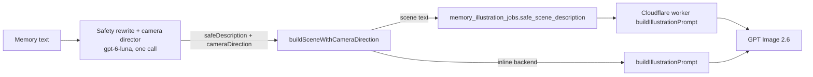

# Feature: Illustration camera direction

**Status:** `done` (backend; ships with the `generate-illustration` deploy)
**Last updated:** 2026-11-06
**PRD reference:** memory illustrations ([memories.md](./memories.md))

## Overview

Memory illustrations used to share one composition: a centered medium shot of everyone smiling at the viewer. The **camera director** stages each memory before it's drawn. The existing safety-rewrite call (gpt-6-luna) drafts three shots — a bold one, an unusual but realistic angle, and a quiet observational frame — and picks the one that fits the memory's mood. Funny memories usually get the bold shot, tender ones the bold or unusual one, hard moments the quiet one. Examples: Mara towering over Enzo's train track seen from the floor; the "te quiero" from the back seat seen in the rear-view mirror; the hug the wind carried away drawn as a little cloud. The art style is unchanged.

## User-facing behavior

- New and regenerated illustrations get more varied, story-specific framing. Nothing in the app UI changes.
- When the model returns no usable shot, the illustration renders exactly as before (scene text only).

## Architecture



`buildSafetySystemPrompt` (in `_shared/prompts.ts`) appends `CAMERA_DIRECTION_INSTRUCTIONS`, so the one call returns `{safeDescription, expressionStyle, shotOptions, cameraDirection}`. `generate-illustration` passes `safeDescription` and `cameraDirection` to `buildSceneWithCameraDirection`. That appends `Camera and staging (the most important composition instruction…): <shot>` on a new line after the description, trimmed and capped at 900 characters. The combined string is what both backends render: the Cloudflare job row stores it in `safe_scene_description`, so the worker and the job schema needed no change.

## Data model

No new columns. `memory_illustration_jobs.safe_scene_description` now holds the scene plus the camera line. It's scrubbed with the rest of the prompt inputs on completion or supersede, exactly as before.

## API & Edge Functions

| Function | Change |
|----------|--------|
| `generate-illustration` | Composes the scene with `buildSceneWithCameraDirection` for both the job insert and the inline prompt. |
| `workflow-illustration-bridge` / worker | Unchanged; they pass `safe_scene_description` through. |

## Extension guide

**Safe to extend**

- The toolbox and the example in `CAMERA_DIRECTION_INSTRUCTIONS`. Keep the example unrelated to the eval memories, or the eval stops measuring generalization.

**Do not change without updating this doc**

- The shot rules. Each one exists because of a failure seen in the 2026-11-06 evals:
  - Only people the memory mentions: a "parent's POV" once added an untagged searcher.
  - Never describe appearance: models invented eye color and glasses.
  - A child in a bath scene is out of the water: in-tub shots got OpenAI image 400s.
  - Kids sit in the back seat: renders put a toddler in the front seat.
  - Everyone faces the camera with both eyes visible, with no over-the-shoulder or from-behind shots: production renders of a child seen from behind came out with distorted eyes and a hand growing from her stomach (2026-11-06).
  - Never draw speech or sound as waves or symbols: the owner found them cluttered. This replaced an earlier "make sounds visible" idea.
  - Hard moments take the quiet shot.
- The `Camera and staging` lead wording. Without "follow it literally… never fall back to a centered medium shot", GPT Image softens extreme angles back to a medium shot.

**Common extension patterns**

- Testing a different director model or prompt: `npm run eval:illustration -- --memory-id <uuid> --director 1 --director-model gpt-6.1-sol --director-model gpt-6-luna`. That runs an eval-only director (`buildDirectorSystemPrompt` in the eval script) on the same safety rewrite.
- `--shot "label: text"` renders a hand-written shot. A plain `npm run eval:illustration -- --memory-id <uuid>` reproduces the production prompt, including its camera pick.

## Constraints & gotchas

- The director's text reaches the image model, so it inherits the safety rewrite's child-safe rules. It runs in the same call, with the same system prompt.
- Latency: the combined call takes a few seconds longer than the old gpt-4o-mini safety rewrite. It overlaps emotion analysis on the speculative path, and the illustration is async.
- Single-pick mode tends to converge on "camera on the floor, looking slightly up" (round 3 eval). Drafting three options before picking is what keeps the variety; don't collapse it to one shot.
- No memory content is logged. The eval prints shots to the operator's terminal only.

## Dependencies

- Depends on: [memories.md](./memories.md) illustration pipeline, the safety rewrite, `_shared/openai.ts` `chatJson` (gpt-6-luna).
- Used by: memory illustrations only. Holiday/birthday card fronts build their own scenes and are unaffected.

## Testing

### Edge Function tests (Deno)

| File | Covers |
|------|--------|
| `supabase/functions/_shared/prompts.test.ts` | Safety prompt asks for `shotOptions` + `cameraDirection` and carries the bath/appearance/hard-moment rules; `buildSceneWithCameraDirection` appends, ignores blank/non-string shots, caps length |
| `supabase/functions/generate-illustration/index.test.ts` | The Cloudflare job row's `safe_scene_description` carries the camera line |
| `supabase/functions/_shared/openai.test.ts` | `chatJson` / vision helpers send `gpt-6-luna` with `reasoning_effort`, no `temperature` |

### Run this feature's tests

```bash
npm run test:edge
npm run eval:illustration -- --memory-id <uuid>
```

## Changelog

| Date | Change |
|------|--------|
| 2026-11-07 | Production fix: faces toward camera, no over-the-shoulder, no drawn sound; car-seat rule must be stated in the shot |
| 2026-11-06 | Initial implementation: director folded into the safety rewrite on gpt-6-luna; evals on 12–16 real memories (three rounds) |
