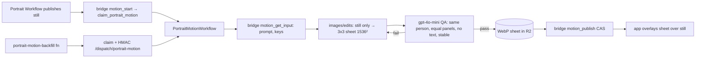

# Living portraits

Animated "living portrait" loops over each person's current character portrait.

**Status:** `done`
**Last updated:** 2026-11-05
**Plan:** [docs/plans/living-portraits.md](../plans/living-portraits.md) (contracts, rollout)

## User-facing behavior

- The current portrait quietly comes alive: a soft breath, a slight head tilt, one
  blink, the smile warming and settling. No hands or gestures. It loops forever:
  frame 1 held 800ms, then 150ms per frame, **hard cuts** (crossfading ghosted two
  heads and was rejected).
- Shown on three surfaces only: the member profile header and the Family tab cast
  cards (both `CastCard` → `FamilyProfilePortraitPhoto animated`), and the onboarding
  reveal (`app/(onboarding)/reveal.tsx`). Everywhere else (chips, pickers, footers,
  full-screen viewer) stays still.
- The still always renders first and stays underneath; the loop appears once its
  sheet has loaded. Reduce Motion → still only. App backgrounded → paused on frame 1.
- After a new photo: the still appears as it does today; ~15–25s later the portrait
  comes alive (live via the portrait-versions Realtime channel).
- A regenerated still hides its old loop until a new one is published. Older portrait
  versions on the timeline never animate.
- Failures are silent: the person keeps the still.

## Architecture

- **State** lives on `family_member_portrait_versions.motion_*` (migration
  `20261105150000_portrait_motion.sql`). Clients cannot write it (guard trigger).
- **Claim → publish CAS:** `claim_portrait_motion` mints a token and the deterministic
  key `<owner>/family/<member>/portraits/<version>/motion/<token>.webp`;
  `publish_portrait_motion` only succeeds while the token is current and
  `illustrated_profile_key = motion_source_key`. A superseded sheet is deleted by the Worker.
- **Display rule** (`src/utils/portrait-motion.ts`): show only when `motion_status = 'ready'`,
  `motion_key` set and `motion_source_key === illustrated_profile_key`.
- **Retry:** up to 2 edit attempts per claim (retryable provider error or QA fail);
  moderation/non-retryable stops immediately. A failed claim is terminal for that still;
  a new still (or the backfill with `p_force`) starts fresh.
- **Prompts** are server-side: `buildPortraitMotionPrompt` / `PORTRAIT_MOTION_CHECK_PROMPT`
  in `supabase/functions/_shared/prompts.ts`, served by `motion_get_input`.
- **Cost:** ~$0.072 per sheet + ~$0.001 QA, recorded as telemetry-only ledger operations
  `portrait_motion` / `portrait_motion_check` — **never counted toward fair-use caps**
  (caps read `ai_image_generation_requests`).
- **Deletion/URLs:** `motion_key` is covered by `get-media-url` authorization
  (`_shared/family-access.ts`, `portrait_version_motion` key kind), `delete-portrait-version`,
  `delete-family-member`, `hard-delete-expired-accounts` and `delete-storage-object`.
  Clients can never upload to a motion key (`isAllowedUploadKey`).

## Backfill

`npm run backfill:portrait-motion -- [--dry-run] [--batch 10] [--pause 45]` loops the
`portrait-motion-backfill` Edge Function (service-role bearer or `x-cron-secret`) until no
member's current portrait is missing a loop. A claim whose dispatch failed stays `pending`
and becomes eligible again after 15 minutes.

## Iterating on the motion

`npm run eval:portrait -- --member-id <id> --sprite --grid 3x3` renders a sheet locally from a
member's current portrait (`--motion wave` for the rejected waving variant, `--grid 3x2` for 6
frames). Slice/encode with ffmpeg to review, **hard cuts only**. Change the production prompt in
`_shared/prompts.ts` (keep the eval's `livingSpritePrompt` in sync) and backfill with `p_force`
only if the change is worth ~$0.07 per person.

## Extending

- New surface: render `<LivingPortraitOverlay motion={getPortraitMotion(version)} />` inside a
  box that already clips the still; never in lists with many items (each overlay decodes a
  sheet at up to 3× the box size).
- Different grid: the bridge serves `columns`/`rows`; the app reads them from the row, so a new
  grid needs only the prompt + `motion_get_input` change.
